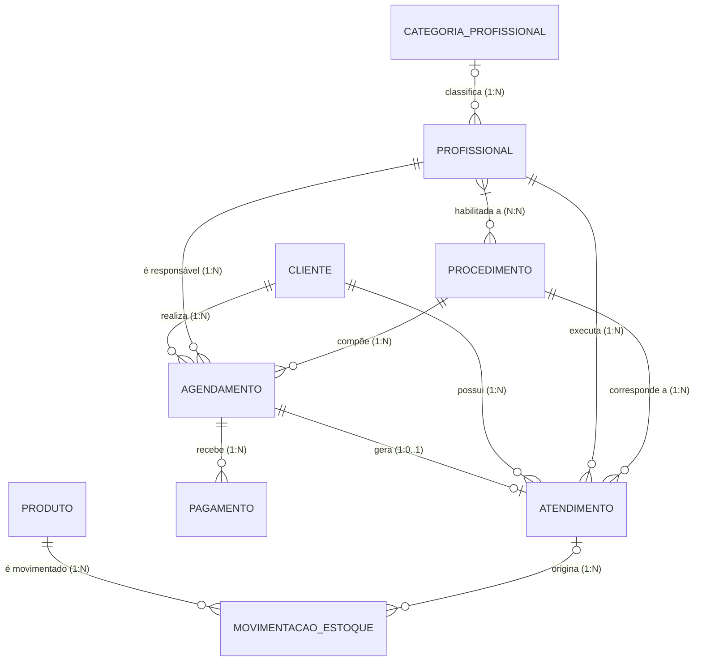
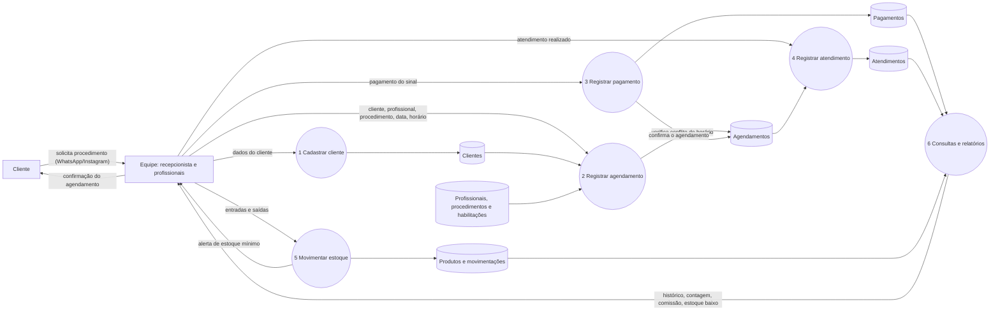
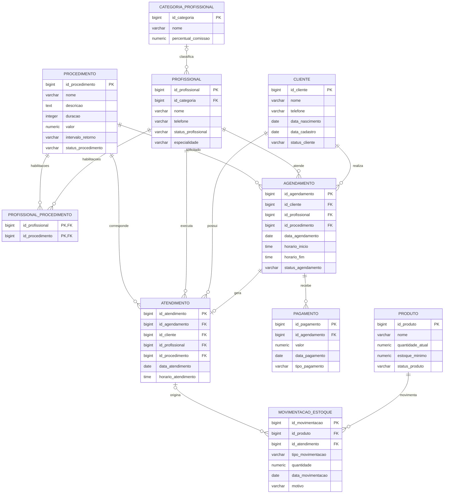

# Hillary Beauty --- Modelagem de Banco de Dados

# Integrantes do grupo

|Integrante|RGM|
|-|-|
|Tiago Henrique Stockmann Teixeira| 47039311 |
|Victor Chouzende dos Santos| 46910433 |
|Carlos Eduardo Azevedo Alves| 47307650 |
|Davi Henrique Santos||              

## Sobre o Projeto

Este projeto apresenta a **modelagem de um banco de dados para a Hillary
Beauty**, um studio de beleza localizado na Rua Nelson de Oliveira, 55,
São Paulo --- SP, Brasil.

WhatsApp: 11986194148

Instagram: \_hillarybeauty

A empresa atua na área de estética e beleza e conta atualmente com
**cinco profissionais** responsáveis pela realização dos procedimentos e
com uma **recepcionista**.

Atualmente, o processo de atendimento é realizado principalmente por
meio de **WhatsApp e Instagram**. Os clientes entram em contato com uma
das representantes, solicitam um procedimento, e a profissional verifica
manualmente sua disponibilidade de agenda. Quando existe
disponibilidade, o agendamento é realizado pela própria conversa e
posteriormente anotado em um bloco de notas.

A empresa também não possui atualmente um sistema estruturado para:

-   Cadastro de clientes;
-   Controle de agendamentos;
-   Controle da quantidade de atendimentos;
-   Histórico dos atendimentos;
-   Cadastro de produtos;
-   Controle de estoque;
-   Registro de entradas e saídas de produtos;
-   Controle da disponibilidade das profissionais;
-   Relacionamento entre clientes, profissionais e procedimentos.

Diante desse cenário, este projeto propõe uma estrutura de banco de
dados capaz de **centralizar, organizar e preservar essas informações**,
reduzindo problemas decorrentes do controle manual.

------------------------------------------------------------------------

# Objetivo do Projeto

O objetivo principal é desenvolver uma **modelagem de banco de dados
estruturada** para apoiar os processos de atendimento, agendamento,
cadastro de clientes, controle de profissionais, procedimentos,
pagamentos e gerenciamento de estoque da Hillary Beauty.

O banco de dados deverá permitir que as informações sejam armazenadas de
forma organizada e relacionadas entre si, possibilitando maior controle
sobre as operações realizadas pela empresa.

Entre os principais objetivos estão:

-   Centralizar os dados dos clientes;
-   Organizar os agendamentos;
-   Evitar conflitos de horários;
-   Controlar os profissionais responsáveis pelos procedimentos;
-   Registrar os atendimentos realizados;
-   Registrar o sinal e os pagamentos dos agendamentos;
-   Manter o histórico de cada cliente;
-   Contabilizar a quantidade de atendimentos;
-   Apoiar o cálculo da comissão por categoria de profissional;
-   Controlar esmaltes, EPIs e descartáveis em estoque;
-   Registrar entradas e saídas do estoque;
-   Evitar estoque negativo;
-   Identificar produtos próximos ou abaixo do estoque mínimo;
-   Garantir maior integridade das informações.

------------------------------------------------------------------------

# Delimitação do Escopo

Esta entrega contém o **modelo conceitual** do banco de dados (revisado
após a avaliação) e o **modelo lógico implementado em PostgreSQL, no
Supabase** (seção "Modelo Lógico" e pasta `banco-logico/`). Não fazem
parte do escopo:

  -----------------------------------------------------------------------
  Fora do escopo                      Motivo
  ----------------------------------- -----------------------------------
  Contas a pagar, fluxo de caixa e    O levantamento tratou do sinal, dos
  conciliação financeira              pagamentos dos atendimentos e da
                                      comissão por categoria; não tratou
                                      de controle financeiro geral

  Emissão de documentos fiscais       Depende de regras tributárias
  (NF-e, NFS-e)                       externas ao funcionamento observado

  Cadastro de fornecedores e ordens   O levantamento não detalhou o
  de compra                           processo de compra; as entradas de
                                      estoque são registradas na
                                      movimentação, com motivo

  Interface gráfica e implementação   O produto desta etapa é o modelo de
  do sistema                          dados, não o software

  Perfis de acesso e permissões por   Tratados apenas como requisito não
  usuário                             funcional, sem modelagem de
                                      entidades
  -----------------------------------------------------------------------

A entidade `Produto` é modelada como **insumo de consumo geral**
(esmaltes, EPIs e descartáveis), e não como mercadoria revendida ao
cliente. Os demais materiais usados nos procedimentos não têm controle
de estoque na organização.

------------------------------------------------------------------------

# Contexto da Empresa

**Empresa:** Hillary Beauty\
**Segmento:** Estética e beleza\
**Localização:** Rua Nelson de Oliveira, 55, São Paulo --- SP, Brasil\
**Equipe:** 5 profissionais que realizam procedimentos e recepcionista\
**Forma atual de agendamento:** WhatsApp e Instagram\
**Controle atual:** Conversas, agenda manual e bloco de notas\
**Controle de estoque:** Não estruturado em sistema próprio\
**Alvarás:** em processo de obtenção

------------------------------------------------------------------------

# Levantamento com a Organização

Além da descrição inicial do cenário, o grupo levantou informações
diretamente com a Hillary Beauty, que fundamentam as entidades, os
atributos e as regras deste documento.

  Registro do contato          Informação
  ---------------------------- ------------
  Data                         03/11
  Forma (visita ou conversa)   Visita

**Informações obtidas:**

-   **Procedimentos oferecidos:** 22 procedimentos, cada um com valor de
    referência e intervalo de retorno (Anexo B).
-   **Política de agendamento:** o horário só é reservado após o
    pagamento de um sinal de 40% do valor do procedimento; atrasos acima
    de 10 minutos podem resultar em cancelamento do atendimento; após a
    confirmação não é possível trocar ou remanejar o horário; em caso de
    falta ou desistência sem justificativa, o sinal não é devolvido; a
    cliente declara ciência dessas regras ao pagar o sinal. A política
    também pede que clientes evitem acompanhantes, o que não tem efeito
    sobre o modelo de dados.
-   **Remuneração das profissionais:** comissão por categoria de
    profissional, com percentual definido pela organização para cada
    categoria (os percentuais não são reproduzidos neste documento).
-   **Estoque:** controlado somente para esmaltes, EPIs e descartáveis.
-   **Equipe:** além das profissionais que realizam procedimentos, há
    recepcionista, que não realiza procedimentos estéticos.
-   **Alvarás:** em processo de obtenção.

------------------------------------------------------------------------

# Problema Identificado

Atualmente, os processos da Hillary Beauty são realizados de maneira
pouco centralizada.

Os clientes entram em contato pelas redes sociais, principalmente
WhatsApp e Instagram, para solicitar um procedimento. A profissional
verifica manualmente sua disponibilidade e realiza o agendamento pela
própria conversa.

Posteriormente, as informações podem ser anotadas em um bloco de notas,
não existindo um banco de dados centralizado para armazenar essas
informações.

Esse processo apresenta alguns riscos:

-   Conflitos de horários;
-   Perda de informações;
-   Dificuldade para consultar agendamentos;
-   Dificuldade para saber quantos atendimentos foram realizados;
-   Falta de histórico organizado dos clientes;
-   Ausência de cadastro estruturado dos clientes;
-   Dificuldade para identificar os procedimentos realizados;
-   Falta de controle sobre os produtos utilizados;
-   Falta de controle sobre a quantidade disponível em estoque;
-   Possibilidade de utilização de produtos sem controle da quantidade
    restante.

------------------------------------------------------------------------

# Motivo da Escolha

A Hillary Beauty foi escolhida por apresentar um cenário real em que a
aplicação de um banco de dados estruturado pode contribuir
significativamente para a organização dos processos da empresa.

A empresa possui processos de atendimento e gerenciamento de clientes
que atualmente são realizados de forma pouco centralizada,
principalmente por meio do WhatsApp e Instagram.

A existência de cinco profissionais e a necessidade de realizar
atendimentos mediante agendamento e pagamento de sinal tornam importante
o controle dos horários disponíveis, dos profissionais responsáveis e
dos procedimentos realizados.

Além disso, existe a necessidade de melhorar o controle dos produtos de
consumo e do estoque disponível.

A ausência de um sistema centralizado pode ocasionar conflitos de
horários, perda de informações, dificuldade na consulta do histórico dos
clientes e falta de controle sobre a quantidade de produtos disponíveis.

Dessa forma, a modelagem proposta busca representar e relacionar
informações sobre **clientes, profissionais, procedimentos,
agendamentos, atendimentos, pagamentos, produtos e movimentações de
estoque**, proporcionando uma visão mais organizada das atividades
realizadas pela empresa.

------------------------------------------------------------------------

# Processo Atual do Negócio


O processo atualmente ocorre da seguinte maneira:

``` text
Cliente
   ↓
Contato pelo WhatsApp ou Instagram
   ↓
Solicitação de procedimento
   ↓
Profissional verifica manualmente a agenda
   ↓
Verificação da disponibilidade
   ↓
Existe disponibilidade?
   ├── NÃO → Cliente recebe outra opção de horário
   │
   └── SIM
         ↓
      Agendamento pela conversa
         ↓
      Pagamento do sinal (40% do valor do procedimento)
         ↓
      Horário reservado após a confirmação do pagamento
         ↓
      Anotação manual em bloco de notas
         ↓
      Realização do procedimento
```

O estoque segue um processo separado e sem controle estruturado:

``` text
Produto utilizado
      ↓
Utilização no procedimento
      ↓
Não existe baixa automática
      ↓
Quantidade disponível não é atualizada
      ↓
Dificuldade para identificar estoque atual
```

------------------------------------------------------------------------

# Modelo Conceitual Proposto

O banco de dados será composto pelas seguintes entidades:

1.  **Cliente**
2.  **Profissional**
3.  **Categoria_Profissional**
4.  **Procedimento**
5.  **Agendamento**
6.  **Atendimento**
7.  **Pagamento**
8.  **Produto**
9.  **Movimentação de Estoque**

Além dessas entidades, existe um relacionamento N:N entre
**Profissional** e **Procedimento** ("habilitada a"), que representa
quais procedimentos cada profissional pode realizar. Ele evita armazenar
vários procedimentos em um único atributo da profissional e, no modelo
lógico, será implementado por uma tabela de ligação.

------------------------------------------------------------------------

# Dicionário de Dados Conceitual

As tabelas a seguir descrevem, para cada entidade do modelo, os
atributos identificados, sua descrição, a regra de negócio associada e o
motivo pelo qual o atributo é necessário.

Os valores citados como exemplo são **fictícios**. Nenhum dado real de
cliente, profissional ou fornecedor da organização é reproduzido neste
documento.

## Convenções do dicionário

  -----------------------------------------------------------------------
  Item                                Convenção
  ----------------------------------- -----------------------------------
  SGBD adotado                        PostgreSQL, hospedado no Supabase

  Versão do dicionário                3.0 (inclui o modelo lógico)

  Codificação e collation             UTF-8; collation pt_BR

  Nomes                               minúsculas, sem acentos, palavras
                                      separadas por `_`, entidades no
                                      singular

  Prefixos e sufixos                  `id_` para identificadores; `data_`
                                      para datas; `horario_` para horas;
                                      `status_` para situações; `tipo_`
                                      para classificações

  Notação                             Chen/pé de galinha no DER;
                                      atributos identificadores marcados
                                      como PK na expressão formal

  Obrigatoriedade                     "Obrigatório" = não pode ser nulo;
                                      "Opcional" = pode ser nulo
  -----------------------------------------------------------------------

## 1. Cliente

A entidade `Cliente` representa as pessoas que utilizam os serviços
oferecidos pela Hillary Beauty.

  -------------------------------------------------------------------------
  Atributo            Descrição         Regra             Motivo da
                                                          obrigatoriedade
  ------------------- ----------------- ----------------- -----------------
  `id_cliente`        Identificador     Único e           Necessário para
                      único do cliente  obrigatório       identificar o
                                                          cliente de forma
                                                          única e manter a
                                                          integridade dos
                                                          relacionamentos
                                                          no banco de
                                                          dados.

  `nome`              Nome completo do  Obrigatório       Necessário para
                      cliente                             identificar
                                                          corretamente o
                                                          cliente nos
                                                          cadastros,
                                                          agendamentos e
                                                          histórico de
                                                          atendimentos.

  `telefone`          Número utilizado  Obrigatório       Necessário para
                      para contato                        permitir a
                                                          identificação e o
                                                          contato com o
                                                          cliente para fins
                                                          de atendimento e
                                                          agendamento.

  `data_nascimento`   Data de           Opcional; deve    Opcional. Apoia a
                      nascimento        ser data válida e identificação de
                                        anterior à data   clientes
                                        atual             homônimos e o
                                                          relacionamento
                                                          com o cliente.

  `data_cadastro`     Data de cadastro  Registrada        Permite saber há
                                        automaticamente   quanto tempo o
                                        pelo sistema      cliente é
                                                          atendido e
                                                          ordenar a base
                                                          por antiguidade.

  `status_cliente`    Situação do       Ativo ou Inativo  Permite inativar
                      cadastro                            o cadastro sem
                                                          excluí-lo,
                                                          preservando o
                                                          histórico de
                                                          atendimentos já
                                                          realizados.
  -------------------------------------------------------------------------

**Regra relacionada:** um cliente deverá estar previamente cadastrado
para realizar ou agendar um procedimento.

## 2. Profissional

A entidade `Profissional` representa as pessoas da equipe da Hillary
Beauty: as cinco profissionais que realizam procedimentos e a
recepcionista, que não realiza procedimentos.

  -----------------------------------------------------------------------------
  Atributo                Descrição         Regra             Motivo da
                                                              obrigatoriedade
  ----------------------- ----------------- ----------------- -----------------
  `id_profissional`       Identificador     Único e           Necessário para
                          único             obrigatório       identificar a
                                                              pessoa de forma
                                                              única e manter a
                                                              integridade dos
                                                              relacionamentos
                                                              no banco de
                                                              dados.

  `nome`                  Nome da pessoa    Obrigatório       Necessário para
                                                              identificar
                                                              corretamente a
                                                              responsável por
                                                              agendamentos e
                                                              atendimentos.

  `telefone`              Telefone          Opcional; deve    Opcional.
                                            ser válido quando Utilizado para
                                            informado         contato interno;
                                                              não é necessário
                                                              para identificar
                                                              a pessoa.

  `status_profissional`   Situação          Ativa ou Inativa  Impede que
                          profissional                        profissionais
                                                              desligadas
                                                              recebam novos
                                                              agendamentos, sem
                                                              apagar os
                                                              atendimentos que
                                                              já realizaram.

  `especialidade`         Área de atuação   Opcional; rótulo  Descreve a área
                                            descritivo, em    em que a
                                            texto livre       profissional
                                                              atua. O controle
                                                              operacional de
                                                              **quais
                                                              procedimentos**
                                                              ela pode executar
                                                              é feito pelo
                                                              relacionamento
                                                              "habilitada a", e
                                                              não por este
                                                              atributo. É
                                                              opcional porque a
                                                              recepcionista não
                                                              atua em
                                                              procedimentos.
  -----------------------------------------------------------------------------

**Regras relacionadas:** uma profissional somente poderá receber um
agendamento para procedimentos que esteja habilitada a realizar; por
isso, quem não possui habilitação (como a recepcionista) não recebe
agendamentos. Profissionais inativas não poderão receber novos
agendamentos.

## 3. Categoria_Profissional

A entidade `Categoria_Profissional` representa as categorias usadas pela
organização para definir o percentual de comissão de cada profissional.

  -----------------------------------------------------------------------------
  Atributo                Descrição         Regra             Motivo da
                                                              obrigatoriedade
  ----------------------- ----------------- ----------------- -----------------
  `id_categoria`          Identificador     Único e           Necessário para
                          único             obrigatório       identificar a
                                                              categoria e
                                                              relacioná-la às
                                                              profissionais.

  `nome`                  Nome da categoria Obrigatório       Necessário para
                                                              identificar a
                                                              categoria.

  `percentual_comissao`   Percentual de     Obrigatório;      Necessário para
                          comissão da       entre 0 e 100     apurar a
                          categoria                           comissão. O
                                                              percentual
                                                              depende da
                                                              categoria, e não
                                                              de cada
                                                              profissional; por
                                                              isso fica nesta
                                                              entidade, sem
                                                              repetição.
  -----------------------------------------------------------------------------

**Regra relacionada:** a comissão não é armazenada: é apurada pelo
percentual da categoria sobre o valor cobrado dos atendimentos
realizados pela profissional.

## 4. Procedimento

A entidade `Procedimento` representa os serviços estéticos e de beleza
oferecidos pela empresa.

  -----------------------------------------------------------------------------
  Atributo                Descrição         Regra             Motivo da
                                                              obrigatoriedade
  ----------------------- ----------------- ----------------- -----------------
  `id_procedimento`       Identificador     Único e           Necessário para
                          único             obrigatório       identificar o
                                                              procedimento de
                                                              forma única e
                                                              manter a
                                                              integridade dos
                                                              relacionamentos
                                                              no banco de
                                                              dados.

  `nome`                  Nome do           Obrigatório       Necessário para
                          procedimento                        identificar
                                                              corretamente o
                                                              serviço oferecido
                                                              e permitir sua
                                                              utilização nos
                                                              agendamentos e
                                                              atendimentos.

  `descricao`             Descrição do      Opcional          Opcional. Detalha
                          procedimento                        o que o serviço
                                                              inclui, sem
                                                              impacto sobre as
                                                              regras do
                                                              sistema.

  `duracao`               Tempo estimado do Obrigatório       Necessário para
                          procedimento                        calcular o
                                                              horário de
                                                              término e
                                                              verificar
                                                              conflitos de
                                                              agenda.

  `valor`                 Valor de          Maior ou igual a  Necessário para
                          referência ("a    zero              informar o preço
                          partir de")                         de referência ao
                                                              cliente e
                                                              calcular o sinal.
                                                              Alguns
                                                              procedimentos têm
                                                              preço variável
                                                              (por área, região
                                                              ou sessão); o
                                                              valor
                                                              efetivamente
                                                              cobrado fica
                                                              registrado em
                                                              `Pagamento`.

  `intervalo_retorno`     Intervalo         Opcional; texto   Opcional. Apoia o
                          recomendado entre descritivo (ex.:  retorno do
                          sessões ou        "35 dias",        cliente; em
                          retorno           "depende de       alguns
                                            avaliação")       procedimentos o
                                                              intervalo depende
                                                              de avaliação e
                                                              não pode ser
                                                              padronizado.

  `status_procedimento`   Situação do       Ativo ou Inativo  Impede que
                          procedimento                        procedimentos
                                                              descontinuados
                                                              sejam agendados,
                                                              preservando os
                                                              atendimentos já
                                                              realizados com
                                                              eles.
  -----------------------------------------------------------------------------

**Regras relacionadas:** o procedimento deverá estar cadastrado e ativo
para poder ser agendado. A duração será utilizada para determinar o
horário de término do agendamento.

## 5. Agendamento

A entidade `Agendamento` representa a reserva de um horário para que
determinado cliente realize um procedimento com uma profissional.

  ----------------------------------------------------------------------------
  Atributo               Descrição         Regra             Motivo da
                                                             obrigatoriedade
  ---------------------- ----------------- ----------------- -----------------
  `id_agendamento`       Identificador     Único e           Necessário para
                         único             obrigatório       identificar cada
                                                             agendamento de
                                                             forma única e
                                                             manter seus
                                                             relacionamentos
                                                             no banco de
                                                             dados.

  `id_cliente`           Cliente           Obrigatório       Necessário para
                         relacionado                         identificar quem
                                                             realizará o
                                                             procedimento e
                                                             manter o vínculo
                                                             do agendamento
                                                             com o cliente.

  `id_profissional`      Profissional      Obrigatório       Necessário para
                         responsável                         identificar quem
                                                             realizará o
                                                             procedimento e
                                                             verificar sua
                                                             disponibilidade e
                                                             habilitação.

  `id_procedimento`      Procedimento      Obrigatório       Necessário para
                         solicitado                          identificar qual
                                                             serviço será
                                                             realizado e
                                                             determinar sua
                                                             duração e demais
                                                             regras.

  `data_agendamento`     Data do           Obrigatória       Necessária para
                         procedimento                        definir quando o
                                                             procedimento
                                                             ocorrerá e
                                                             permitir o
                                                             controle da
                                                             agenda.

  `horario_inicio`       Horário de início Obrigatório       Necessário para
                                                             reservar o
                                                             período correto
                                                             na agenda e
                                                             evitar conflitos
                                                             de horários.

  `horario_fim`          Horário de        Determinado pelo  Necessário para
                         término           horário de início verificar
                                           somado à duração  conflitos
                                           do procedimento   considerando o
                                                             intervalo inteiro
                                                             do procedimento,
                                                             e não apenas o
                                                             horário de
                                                             início.

  `status_agendamento`   Situação do       Agendado,         Distingue o que
                         agendamento       Confirmado,       aguarda o sinal
                                           Realizado,        (Agendado), o que
                                           Cancelado ou Não  está com o
                                           Compareceu        horário reservado
                                                             após o pagamento
                                                             do sinal
                                                             (Confirmado), o
                                                             que foi realizado
                                                             e o que foi
                                                             cancelado ou não
                                                             ocorreu.

  `observacao`           Informações       Opcional          Opcional.
                         adicionais                          Registra
                                                             informações
                                                             pontuais
                                                             combinadas com o
                                                             cliente no
                                                             momento do
                                                             agendamento.
  ----------------------------------------------------------------------------

**Regras relacionadas:**

-   O cliente deve estar cadastrado.
-   A profissional deve estar ativa e habilitada para o procedimento.
-   O procedimento deve estar ativo.
-   A profissional deve estar disponível e não podem existir horários
    conflitantes.
-   O horário só é reservado após a confirmação do pagamento do sinal.
-   Após a confirmação, não é possível trocar ou remanejar o horário.
-   Cancelamentos devem liberar o horário.

## 6. Atendimento

A entidade `Atendimento` representa um procedimento que foi efetivamente
realizado.

  ------------------------------------------------------------------------------
  Atributo                Descrição         Regra             Motivo da
                                                              obrigatoriedade
  ----------------------- ----------------- ----------------- ------------------
  `id_atendimento`        Identificador     Único e           Necessário para
                          único             obrigatório       identificar cada
                                                              atendimento de
                                                              forma única e
                                                              manter seu
                                                              histórico e
                                                              relacionamentos.

  `id_agendamento`        Agendamento       Obrigatório       Necessário para
                          relacionado                         comprovar a origem
                                                              do atendimento e
                                                              garantir que ele
                                                              esteja vinculado a
                                                              um agendamento
                                                              existente.

  `id_cliente`            Cliente atendido  Deve corresponder Registra de forma
                                            ao cliente do     definitiva quem
                                            agendamento de    foi atendido,
                                            origem            preservando o
                                                              histórico mesmo
                                                              diante de
                                                              alterações
                                                              posteriores no
                                                              agendamento.

  `id_profissional`       Profissional      Deve corresponder Registra de forma
                          responsável       à profissional do definitiva quem
                                            agendamento de    executou o
                                            origem            procedimento,
                                                              servindo de base
                                                              para a
                                                              contabilização de
                                                              atendimentos por
                                                              profissional.

  `id_procedimento`       Procedimento      Deve corresponder Registra de forma
                          realizado         ao procedimento   definitiva qual
                                            do agendamento de serviço foi
                                            origem            prestado, servindo
                                                              de base para a
                                                              contabilização de
                                                              atendimentos por
                                                              procedimento.

  `data_atendimento`      Data do           Obrigatória       Necessária para
                          atendimento                         registrar quando o
                                                              serviço foi
                                                              efetivamente
                                                              realizado e manter
                                                              o histórico
                                                              cronológico.

  `horario_atendimento`   Horário do        Compatível com o  Registra o horário
                          atendimento       agendamento       em que o
                                                              procedimento
                                                              efetivamente
                                                              ocorreu, que pode
                                                              diferir do horário
                                                              originalmente
                                                              reservado.

  `observacao`            Observações do    Opcional          Opcional. Registra
                          atendimento                         observações sobre
                                                              a execução do
                                                              procedimento.
  ------------------------------------------------------------------------------

**Regras relacionadas:** um atendimento somente poderá ser registrado
quando existir um agendamento correspondente. Os atendimentos realizados
deverão permanecer registrados para formar o histórico do cliente.
Somente atendimentos efetivamente realizados deverão ser contabilizados.

## 7. Pagamento

A entidade `Pagamento` representa os valores pagos referentes a um
agendamento, a começar pelo sinal exigido para reservar o horário.

  ------------------------------------------------------------------------
  Atributo           Descrição         Regra             Motivo da
                                                         obrigatoriedade
  ------------------ ----------------- ----------------- -----------------
  `id_pagamento`     Identificador     Único e           Necessário para
                     único             obrigatório       identificar cada
                                                         pagamento de
                                                         forma única e
                                                         preservar seu
                                                         histórico.

  `id_agendamento`   Agendamento       Obrigatório       O sinal é pago
                     relacionado                         antes de existir
                                                         atendimento; por
                                                         isso o pagamento
                                                         se vincula ao
                                                         agendamento.

  `valor`            Valor pago        Estritamente      Necessário para
                                       maior que zero    registrar quanto
                                                         foi pago e apurar
                                                         o valor cobrado
                                                         do atendimento.

  `data_pagamento`   Data do pagamento Obrigatória       Necessária para
                                                         registrar quando
                                                         o pagamento
                                                         ocorreu e
                                                         confirmar o
                                                         agendamento.

  `tipo_pagamento`   Tipo do pagamento Sinal ou Restante Distingue o
                                                         sinal, que
                                                         confirma o
                                                         agendamento, do
                                                         pagamento do
                                                         saldo.
  ------------------------------------------------------------------------

**Regras relacionadas:** o sinal corresponde a 40% do valor do
procedimento. O agendamento só passa a Confirmado após o pagamento do
sinal. Em falta ou desistência sem justificativa, o sinal não é
devolvido.

## 8. Produto

A entidade `Produto` representa os itens de consumo controlados em
estoque: esmaltes, EPIs e descartáveis.

  --------------------------------------------------------------------------
  Atributo             Descrição         Regra             Motivo da
                                                           obrigatoriedade
  -------------------- ----------------- ----------------- -----------------
  `id_produto`         Identificador     Único e           Necessário para
                       único             obrigatório       identificar o
                                                           produto de forma
                                                           única e manter a
                                                           integridade das
                                                           movimentações de
                                                           estoque.

  `nome`               Nome do produto   Obrigatório       Necessário para
                                                           identificar
                                                           corretamente o
                                                           produto e
                                                           permitir seu
                                                           controle no
                                                           estoque.

  `descricao`          Características   Opcional          Opcional. Detalha
                       do produto                          marca, volume ou
                                                           composição do
                                                           produto.

  `unidade_medida`     Unidade de        Valores           Necessário para
                       controle          controlados:      que a quantidade
                                         unidade, ml, g    em estoque tenha
                                                           significado e
                                                           para que as
                                                           movimentações
                                                           sejam comparáveis
                                                           entre si.

  `quantidade_atual`   Quantidade        Nunca pode ser    Necessário para
                       disponível        negativa; resulta consultar o saldo
                                         das entradas      disponível e
                                         menos as saídas   sinalizar
                                                           reposição sem
                                                           recalcular todas
                                                           as movimentações
                                                           a cada consulta.

  `estoque_minimo`     Limite mínimo     Maior ou igual a  Necessário para
                                         zero              definir o limite
                                                           a partir do qual
                                                           o sistema
                                                           sinaliza a
                                                           necessidade de
                                                           reposição.

  `status_produto`     Situação do       Ativo ou Inativo  Impede que
                       produto                             produtos
                                                           descontinuados
                                                           recebam novas
                                                           saídas,
                                                           preservando as
                                                           movimentações já
                                                           registradas.
  --------------------------------------------------------------------------

**Regras relacionadas:** o produto deverá estar cadastrado; a quantidade
nunca poderá ser negativa; produtos inativos não receberão novas saídas;
o sistema deverá sinalizar produtos abaixo ou no estoque mínimo.

## 9. Movimentação de Estoque

A entidade `Movimentacao_Estoque` representa as entradas e saídas dos
produtos. O consumo é geral, isto é, a saída não precisa estar vinculada
a um atendimento.

  ---------------------------------------------------------------------------
  Atributo              Descrição         Regra             Motivo da
                                                            obrigatoriedade
  --------------------- ----------------- ----------------- -----------------
  `id_movimentacao`     Identificador     Único e           Necessário para
                        único             obrigatório       identificar cada
                                                            movimentação de
                                                            estoque de forma
                                                            única e preservar
                                                            seu histórico.

  `id_produto`          Produto           Obrigatório       Necessário para
                        movimentado                         identificar qual
                                                            produto teve sua
                                                            quantidade
                                                            alterada e manter
                                                            a integridade do
                                                            estoque.

  `tipo_movimentacao`   Entrada ou saída  Valores           Necessário para
                                          controlados:      determinar se a
                                          Entrada ou Saída  quantidade
                                                            disponível será
                                                            somada ou
                                                            subtraída.

  `quantidade`          Quantidade        Estritamente      Necessário para
                        movimentada       maior que zero    calcular a
                                                            alteração do
                                                            saldo; uma
                                                            movimentação de
                                                            quantidade zero
                                                            não altera o
                                                            estoque.

  `data_movimentacao`   Data da           Obrigatória       Necessária para
                        movimentação                        registrar quando
                                                            a alteração de
                                                            estoque ocorreu e
                                                            manter o
                                                            histórico das
                                                            movimentações.

  `motivo`              Justificativa da  Obrigatório nas   Justifica
                        movimentação      entradas e nas    movimentações
                                          saídas não        como compras,
                                          ligadas a         consumo geral,
                                          atendimento       perdas e
                                                            vencimentos.

  `id_atendimento`      Atendimento       Opcional          Opcional. Permite
                        relacionado                         rastrear a saída
                                                            ao atendimento
                                                            quando o consumo
                                                            puder ser
                                                            atribuído a um.
  ---------------------------------------------------------------------------

**Regras relacionadas:** uma entrada aumenta a quantidade disponível;
uma saída reduz a quantidade disponível; uma saída somente pode ocorrer
quando houver quantidade suficiente em estoque.

------------------------------------------------------------------------

# Relacionamentos e Cardinalidades

As cardinalidades indicam, para cada entidade, **(mínimo, máximo)** de
vezes em que uma ocorrência dela participa do relacionamento.

  ------------------------------------------------------------------------------------------
  Relacionamento   Cardinalidade   Entidade A               Entidade B     Leitura
  ---------------- --------------- ------------------------ -------------- -----------------
  realiza          1:N             Cliente (0,N)            Agendamento    Um cliente
                                                            (1,1)          realiza zero ou
                                                                           vários
                                                                           agendamentos;
                                                                           cada agendamento
                                                                           pertence a
                                                                           exatamente um
                                                                           cliente.

  é responsável    1:N             Profissional (0,N)       Agendamento    Cada agendamento
                                                            (1,1)          tem exatamente
                                                                           uma profissional
                                                                           responsável.

  compõe           1:N             Procedimento (0,N)       Agendamento    Cada agendamento
                                                            (1,1)          corresponde a
                                                                           exatamente um
                                                                           procedimento.

  gera             1:0..1          Agendamento (0,1)        Atendimento    Um agendamento
                                                            (1,1)          gera no máximo um
                                                                           atendimento
                                                                           (cancelamentos e
                                                                           não
                                                                           comparecimentos
                                                                           não geram); todo
                                                                           atendimento vem
                                                                           de exatamente um
                                                                           agendamento.

  recebe           1:N             Agendamento (0,N)        Pagamento      Um agendamento
                                                            (1,1)          recebe zero ou
                                                                           vários pagamentos
                                                                           (zero enquanto
                                                                           aguarda o sinal);
                                                                           cada pagamento
                                                                           pertence a
                                                                           exatamente um
                                                                           agendamento.

  possui           1:N             Cliente (0,N)            Atendimento    Cada atendimento
                                                            (1,1)          pertence a
                                                                           exatamente um
                                                                           cliente.

  executa          1:N             Profissional (0,N)       Atendimento    Cada atendimento
                                                            (1,1)          tem exatamente
                                                                           uma profissional
                                                                           responsável.

  corresponde a    1:N             Procedimento (0,N)       Atendimento    Cada atendimento
                                                            (1,1)          corresponde a
                                                                           exatamente um
                                                                           procedimento.

  é movimentado    1:N             Produto (0,N)            Movimentação   Cada movimentação
                                                            (1,1)          pertence a
                                                                           exatamente um
                                                                           produto.

  origina          1:N             Atendimento (0,N)        Movimentação   Uma movimentação
                                                            (0,1)          pode, ou não,
                                                                           estar ligada a um
                                                                           atendimento
                                                                           (entradas e
                                                                           consumo geral não
                                                                           estão).

  habilitada a     N:N             Profissional (0,N)       Procedimento   Uma profissional
                                                            (1,N)          pode estar
                                                                           habilitada a
                                                                           vários
                                                                           procedimentos (a
                                                                           recepcionista, a
                                                                           nenhum); todo
                                                                           procedimento tem
                                                                           ao menos uma
                                                                           profissional
                                                                           habilitada.
                                                                           Relacionamento
                                                                           N:N.

  classifica       1:N             Categoria_Profissional   Profissional   Cada profissional
                                   (0,N)                    (0,1)          pertence a no
                                                                           máximo uma
                                                                           categoria de
                                                                           comissão.
  ------------------------------------------------------------------------------------------

------------------------------------------------------------------------

# Resumo das Entidades

  -----------------------------------------------------------------------
  Entidade                            Finalidade
  ----------------------------------- -----------------------------------
  **Cliente**                         Armazenar os dados e informações
                                      dos clientes

  **Profissional**                    Controlar a equipe (profissionais e
                                      recepcionista) e seus dados

  **Categoria_Profissional**          Definir o percentual de comissão
                                      por categoria

  **Procedimento**                    Cadastrar os serviços oferecidos

  **Agendamento**                     Controlar datas, horários,
                                      clientes, profissionais e
                                      procedimentos

  **Atendimento**                     Registrar os procedimentos
                                      efetivamente realizados

  **Pagamento**                       Registrar o sinal e os pagamentos
                                      dos agendamentos

  **Produto**                         Cadastrar e acompanhar esmaltes,
                                      EPIs e descartáveis

  **Movimentação_Estoque**            Registrar entradas e saídas dos
                                      produtos
  -----------------------------------------------------------------------

O relacionamento N:N **habilitada a** controla quais procedimentos cada
profissional pode realizar.

------------------------------------------------------------------------

# Requisitos do Sistema

## 1. Cadastro de Clientes

O sistema deverá permitir cadastrar, consultar, alterar e inativar
clientes, armazenando nome, telefone, data de nascimento, data de
cadastro, status e histórico de atendimentos.

## 2. Gerenciamento de Agendamentos

O sistema deverá permitir realizar agendamentos informando cliente,
procedimento, profissional, data e horário, verificar automaticamente a
disponibilidade da profissional e impedir conflitos de horários.

## 3. Controle de Atendimentos e Pagamentos

O sistema deverá registrar cada atendimento realizado, relacionando
cliente, profissional, procedimento, agendamento, data e horário,
permitir consultar o histórico e a quantidade de atendimentos, e
registrar o sinal e os demais pagamentos dos agendamentos.

## 4. Controle de Estoque

O sistema deverá permitir cadastrar produtos, registrar entradas e
saídas, atualizar automaticamente a quantidade disponível, identificar
estoque baixo e impedir estoque negativo.

------------------------------------------------------------------------

# Requisitos Funcionais

### RF01 --- Cadastro de clientes

O sistema deve permitir cadastrar, consultar, alterar e inativar
clientes, armazenando seus dados pessoais e informações de contato.

### RF02 --- Gerenciamento de agendamentos

O sistema deve permitir registrar um agendamento informando cliente,
procedimento, profissional, data e horário, verificando automaticamente
a disponibilidade da agenda.

### RF03 --- Registro de atendimentos

O sistema deve permitir registrar um atendimento realizado, vinculando o
cliente, profissional, procedimento e agendamento, mantendo um histórico
dos atendimentos.

### RF04 --- Controle de estoque

O sistema deve permitir cadastrar produtos e registrar suas entradas e
saídas, atualizando automaticamente a quantidade disponível em estoque.

### RF05 --- Cadastro de profissionais

O sistema deve permitir cadastrar, consultar, alterar e inativar
profissionais, armazenando nome, telefone, especialidade, categoria e
situação.

### RF06 --- Habilitação de procedimentos por profissional

O sistema deve permitir registrar e consultar quais procedimentos cada
profissional está habilitada a executar.

### RF07 --- Cadastro de procedimentos

O sistema deve permitir cadastrar, consultar, alterar e inativar
procedimentos, armazenando nome, descrição, duração, valor de
referência, intervalo de retorno e situação.

### RF08 --- Verificação de conflito de horários

O sistema deve impedir o registro de um agendamento cuja profissional já
possua outro agendamento no mesmo intervalo, considerando o horário de
início e o horário de término.

### RF09 --- Validação de profissional habilitada

O sistema deve impedir o agendamento de um procedimento para o qual a
profissional selecionada não esteja habilitada.

### RF10 --- Cancelamento de agendamento

O sistema deve permitir cancelar um agendamento, liberando o horário da
profissional. Após a confirmação do agendamento, o sistema não deve
permitir a troca ou o remanejamento de data ou horário.

### RF11 --- Impedimento de estoque negativo

O sistema deve impedir o registro de uma saída de estoque cuja
quantidade seja superior à quantidade disponível do produto.

### RF12 --- Alerta de estoque mínimo

O sistema deve sinalizar os produtos cuja quantidade atual esteja igual
ou abaixo do estoque mínimo definido.

### RF13 --- Consultas e contabilização de atendimentos

O sistema deve permitir consultar a quantidade de atendimentos
realizados por cliente, profissional, procedimento e período,
considerando somente os atendimentos efetivamente registrados.

### RF14 --- Registro de pagamentos e confirmação do agendamento

O sistema deve permitir registrar os pagamentos de um agendamento, e
confirmar o agendamento somente após o registro do pagamento do sinal.

### RF15 --- Apuração de comissão

O sistema deve permitir consultar a comissão devida a cada profissional
por período, aplicando o percentual da sua categoria ao valor cobrado
dos atendimentos realizados.

------------------------------------------------------------------------

# Requisitos Não Funcionais

## RNF01 --- Desempenho

O sistema deve responder às consultas e operações realizadas pelo
usuário em até **3 segundos**, mesmo durante o acesso simultâneo de
diferentes profissionais.

## RNF02 --- Segurança

O sistema deve proteger os dados dos clientes e usuários por meio de
autenticação com login e senha.

Somente usuários autorizados deverão ter acesso às informações do
sistema.

## RNF03 --- Usabilidade

O sistema deve possuir uma interface simples, intuitiva e responsiva.

As profissionais devem conseguir realizar cadastros, agendamentos,
registros de atendimentos e consultas de estoque de maneira rápida e
fácil.

## RNF04 --- Disponibilidade e Integridade

O sistema deve estar disponível durante o horário de funcionamento da
Hillary Beauty.

Os dados devem ser armazenados de maneira segura, evitando perda ou
inconsistência das informações.

## RNF05 --- Conformidade com a LGPD

O sistema trata dados pessoais de clientes (nome, telefone e data de
nascimento), enquadrando-se na Lei nº 13.709/2018 (Lei Geral de Proteção
de Dados Pessoais).

O acesso a esses dados deve ser restrito às profissionais autorizadas,
com finalidade limitada ao atendimento e ao agendamento. O sistema deve
prever a inativação do cadastro em vez da exclusão física, preservando o
histórico, e deve permitir o atendimento a pedidos de exclusão feitos
pelo próprio titular dos dados. Os detalhes estão na seção "LGPD no
Dicionário de Dados".

------------------------------------------------------------------------

# Regras de Negócio

## Cadastro de Clientes

Todo cliente que realizar ou agendar um procedimento deverá estar
previamente cadastrado no sistema.

O cadastro deverá conter, no mínimo: nome e telefone. A data de
nascimento é opcional.

## Cadastro de Profissionais

Cada pessoa da equipe deverá possuir um cadastro individual.

O sistema deverá manter informações de identificação, a categoria de
comissão e os procedimentos que a profissional está habilitada a
realizar. A recepcionista não realiza procedimentos e, por isso, não
possui habilitações.

## Cadastro de Procedimentos

Todo procedimento oferecido pela empresa deverá estar cadastrado, com
nome, descrição, duração, valor de referência, intervalo de retorno e
status. Todo procedimento deve ter ao menos uma profissional habilitada.

## Agendamento

Todo agendamento deverá estar obrigatoriamente vinculado a um cliente,
uma profissional, um procedimento, uma data e um horário.

## Reserva de Horário e Sinal

Para confirmar o agendamento é necessário o pagamento de um sinal
correspondente a 40% do valor do procedimento. O horário só é reservado
após a confirmação do pagamento.

## Disponibilidade da Profissional

Uma profissional não poderá possuir dois agendamentos conflitantes no
mesmo período.

O sistema deverá verificar automaticamente a disponibilidade antes de
confirmar um novo agendamento.

## Profissional Habilitada

Um procedimento somente poderá ser agendado com uma profissional que
esteja habilitada a realizá-lo.

## Status do Agendamento

Todo agendamento deverá possuir um status: Agendado (aguardando o
sinal), Confirmado (sinal pago), Realizado, Cancelado ou Não Compareceu.

## Pontualidade

Atrasos superiores a 10 minutos poderão resultar no cancelamento do
atendimento.

## Troca e Remanejamento

Após a confirmação, não é possível trocar ou remanejar o horário
agendado. Quem precisar de outro horário deve cancelar e realizar um
novo agendamento.

## Faltas e Cancelamentos

Em caso de não comparecimento sem justificativa ou desistência, o sinal
não será devolvido.

## Registro do Atendimento

Um atendimento somente poderá ser registrado como realizado quando
estiver relacionado a um agendamento existente.

## Histórico do Cliente

Todos os atendimentos realizados deverão permanecer registrados no
histórico do cliente, permitindo consultar procedimentos realizados,
datas, horários e profissionais responsáveis.

## Contabilização dos Atendimentos

O sistema deverá permitir contabilizar a quantidade de atendimentos
realizados por cliente, profissional, procedimento, período e empresa.
Somente atendimentos efetivamente realizados deverão ser contabilizados.

## Comissão

A comissão de cada profissional é apurada pelo percentual da categoria
sobre o valor cobrado dos atendimentos que realizou. Ela não é
armazenada, apenas calculada.

## Cadastro de Produtos

Todo produto controlado em estoque (esmaltes, EPIs e descartáveis)
deverá possuir cadastro, com nome, descrição, unidade de medida,
quantidade disponível, estoque mínimo e status.

## Entrada e Saída de Produtos

Toda entrada e toda saída de produto deverá ser registrada, ajustando
automaticamente a quantidade disponível. O consumo é geral: a saída não
precisa estar vinculada a um atendimento.

## Estoque Negativo

O sistema não poderá permitir que a quantidade disponível de um produto
fique abaixo de zero.

## Estoque Mínimo

Cada produto poderá possuir uma quantidade mínima definida. Quando o
estoque atingir ou ficar abaixo desse limite, o sistema deverá sinalizar
a necessidade de reposição.

## Cancelamento

Quando um agendamento for cancelado, o horário da profissional deverá
ficar disponível novamente. Um agendamento cancelado não poderá
posteriormente ser registrado como atendimento realizado.

## Conformidade Legal

O tratamento dos dados pessoais deve seguir a LGPD (Lei nº 13.709/2018).
A organização está em processo de obtenção dos alvarás de funcionamento;
o sistema não modela os alvarás.

## Integridade dos Registros

O sistema deverá manter os relacionamentos entre clientes,
profissionais, procedimentos, agendamentos, atendimentos, pagamentos,
produtos e movimentações de estoque. Não deverão existir registros sem
as informações necessárias para manter a integridade do banco.

------------------------------------------------------------------------

# Regras Operacionais

### RO01 --- Cadastro obrigatório do cliente

Um agendamento só poderá ser realizado se o cliente estiver previamente
cadastrado.

### RO02 --- Agendamento condicionado à disponibilidade

Um procedimento somente poderá ser agendado se a profissional
responsável estiver disponível na data e horário solicitados.

### RO03 --- Impedimento de conflito de horários

Uma profissional não poderá possuir dois agendamentos conflitantes.

### RO04 --- Profissional habilitada

Um procedimento somente poderá ser agendado com uma profissional
habilitada.

### RO05 --- Dados obrigatórios

Um agendamento somente poderá ser confirmado quando possuir cliente,
profissional, procedimento, data, horário e o pagamento do sinal.

### RO06 --- Registro do atendimento

Um atendimento somente poderá ser registrado após existir um agendamento
correspondente.

### RO07 --- Histórico de atendimento

Todo atendimento realizado deverá ser registrado no histórico do
respectivo cliente.

### RO08 --- Troca de horário não permitida

Após a confirmação do agendamento, não é permitido trocar ou remanejar
data ou horário.

### RO09 --- Cancelamento

Um agendamento cancelado não poderá ser registrado como atendimento
realizado e deverá liberar o horário da profissional.

### RO10 --- Registro de produtos

Um produto somente poderá ser utilizado no controle de estoque se
estiver previamente cadastrado.

### RO11 --- Saída de estoque

A utilização de um produto deverá gerar uma saída correspondente no
estoque, com motivo, podendo ou não estar vinculada a um atendimento.

### RO12 --- Disponibilidade de estoque

Um produto somente poderá ser utilizado se houver quantidade suficiente
disponível.

### RO13 --- Proibição de estoque negativo

Uma saída não poderá ser registrada quando a quantidade solicitada for
superior à quantidade disponível.

### RO14 --- Entrada de estoque

Uma entrada deverá aumentar automaticamente a quantidade disponível.

### RO15 --- Alerta de estoque baixo

Quando a quantidade atingir ou ficar abaixo do estoque mínimo, o sistema
deverá sinalizar a necessidade de reposição.

### RO16 --- Contabilização

Somente atendimentos registrados como realizados deverão ser
contabilizados.

### RO17 --- Responsabilidade pelo atendimento

Cada atendimento deverá estar associado a uma única profissional
responsável.

### RO18 --- Integridade das informações

Um registro não deverá ser excluído caso sua exclusão provoque perda de
informações necessárias para manter o histórico de agendamentos,
atendimentos, pagamentos ou movimentações de estoque.

### RO19 --- Sinal para reservar o horário

O agendamento só é confirmado, e o horário reservado, após o pagamento
do sinal de 40% do valor do procedimento.

### RO20 --- Atraso

Atrasos superiores a 10 minutos poderão resultar no cancelamento do
atendimento.

### RO21 --- Sinal em faltas e desistências

Em não comparecimento sem justificativa ou desistência, o sinal não é
devolvido.

### RO22 --- Comissão por categoria

A comissão é apurada com o percentual da categoria da profissional, sem
ser armazenada.

As regras RO23 a RO26 foram definidas durante o modelo lógico (ver seção
"Modelo Lógico").

### RO23 --- Horário da cliente

Uma cliente não pode ter dois horários reservados (agendamentos
confirmados) sobrepostos, mesmo com profissionais diferentes.

### RO24 --- Início do agendamento

Todo agendamento é criado como Agendado e só passa a Confirmado após o
pagamento do sinal.

### RO25 --- Estados finais

Um agendamento Cancelado ou Não Compareceu não é reativado. Para outro
horário, cria-se um novo agendamento.

### RO26 --- Movimentações imutáveis

Uma movimentação de estoque registrada não é alterada nem excluída. Para
corrigir um lançamento, registra-se uma movimentação contrária.

------------------------------------------------------------------------

# Diagrama Entidade-Relacionamento (DER)

O diagrama utiliza a notação de pé de galinha (crow's foot), que
representa a cardinalidade **mínima e máxima** nos dois lados de cada
relacionamento. Os símbolos ao lado de uma entidade indicam quantas
ocorrências dela se relacionam com uma ocorrência da outra entidade:
`||` exatamente um; `|o` zero ou um; `o{` zero ou muitos; `}|` um ou
muitos.


```{=html}
<details>
```
```{=html}
<summary>
```
Código-fonte do DER (Mermaid)
```{=html}
</summary>
```


```{=html}
</details>
```
Por se tratar de modelo conceitual, as chaves estrangeiras não aparecem
como atributos: elas estão representadas pelas próprias linhas de
relacionamento e são detalhadas no Apêndice A. Os atributos de cada
entidade estão no Dicionário de Dados.

------------------------------------------------------------------------

# Fluxo de Dados

O fluxo abaixo mostra como os dados circulam no sistema proposto, a
partir dos requisitos funcionais. O contato com o cliente continua pelos
canais atuais; a equipe registra as informações no sistema.


```{=html}
<details>
```
```{=html}
<summary>
```
Código-fonte do fluxo de dados (Mermaid)
```{=html}
</summary>
```


```{=html}
</details>
```

------------------------------------------------------------------------

# Expressão Formal e Tipos (propostos)

Notação: **PK** em negrito; `→` indica chave estrangeira; `[opc]` indica
atributo opcional. Os tipos são **propostos para PostgreSQL** e serão
refinados no modelo lógico. A duração é guardada em minutos.

``` text
Cliente(id_cliente: integer, nome: varchar, telefone: varchar, data_nascimento: date [opc], data_cadastro: date, status_cliente: varchar)
Categoria_Profissional(id_categoria: integer, nome: varchar, percentual_comissao: numeric(5,2))
Profissional(id_profissional: integer, nome: varchar, telefone: varchar [opc], status_profissional: varchar, especialidade: varchar [opc], id_categoria → Categoria_Profissional [opc])
Procedimento(id_procedimento: integer, nome: varchar, descricao: text [opc], duracao: integer, valor: numeric(10,2), intervalo_retorno: varchar [opc], status_procedimento: varchar)
Profissional_Procedimento(id_profissional → Profissional, id_procedimento → Procedimento)   PK composta
Agendamento(id_agendamento: integer, id_cliente → Cliente, id_profissional → Profissional, id_procedimento → Procedimento, data_agendamento: date, horario_inicio: time, horario_fim: time, status_agendamento: varchar, observacao: text [opc])
Atendimento(id_atendimento: integer, id_agendamento → Agendamento (único), id_cliente → Cliente, id_profissional → Profissional, id_procedimento → Procedimento, data_atendimento: date, horario_atendimento: time, observacao: text [opc])
Pagamento(id_pagamento: integer, id_agendamento → Agendamento, valor: numeric(10,2), data_pagamento: date, tipo_pagamento: varchar)
Produto(id_produto: integer, nome: varchar, descricao: text [opc], unidade_medida: varchar, quantidade_atual: numeric, estoque_minimo: numeric, status_produto: varchar)
Movimentacao_Estoque(id_movimentacao: integer, id_produto → Produto, tipo_movimentacao: varchar, quantidade: numeric, data_movimentacao: date, motivo: varchar [cond.], id_atendimento → Atendimento [opc])
```

PK de cada relação: `id_` da própria entidade (exceto
`Profissional_Procedimento`, com PK composta).

------------------------------------------------------------------------

# Índices (propostos)

  ------------------------------------------------------------------------------------------------------
  Índice                                                             Finalidade
  ------------------------------------------------------------------ -----------------------------------
  PK de cada entidade                                                Identificação única (índice criado
                                                                     automaticamente)

  `Cliente(telefone)` e `Cliente(nome)`                              Localizar o cliente a partir do
                                                                     contato recebido

  `Agendamento(id_profissional, data_agendamento, horario_inicio)`   Verificação de conflito de horários
                                                                     (RF08) e consulta da agenda

  Restrição de exclusão sobre o intervalo (profissional, data,       Impedir conflitos de horário
  início--fim) em agendamentos com horário reservado (Confirmado ou  diretamente no banco
  Realizado)                                                         

  Restrição de exclusão sobre o intervalo (cliente, data,            Impedir que a mesma cliente tenha
  início--fim) em agendamentos com horário reservado                 dois horários reservados ao mesmo
                                                                     tempo

  `Agendamento(id_cliente)`                                          Consulta dos agendamentos de um
                                                                     cliente

  `Atendimento(id_agendamento)` único                                Garantir a cardinalidade 0..1 entre
                                                                     agendamento e atendimento

  `Atendimento(id_cliente, data_atendimento)`                        Histórico do cliente

  `Atendimento(id_profissional, data_atendimento)`                   Contagem de atendimentos e comissão
                                                                     por profissional e período

  `Pagamento(id_agendamento)`                                        Consulta dos pagamentos de um
                                                                     agendamento e confirmação do sinal

  `Movimentacao_Estoque(id_produto, data_movimentacao)`              Histórico de movimentações por
                                                                     produto

  `Profissional_Procedimento(id_procedimento)`                       Consulta inversa: quem realiza cada
                                                                     procedimento

  `Log_Auditoria(tabela, id_registro)` e `Log_Auditoria(data_hora)`  Histórico de alterações de um
                                                                     registro e consulta do log por
                                                                     período
  ------------------------------------------------------------------------------------------------------

------------------------------------------------------------------------

# Log

O sistema deverá registrar, com data, hora e usuário, os eventos abaixo.

-   Criação e cancelamento de agendamentos;
-   Confirmação do agendamento e registro de pagamentos;
-   Registro de atendimentos;
-   Inativação de clientes, profissionais, procedimentos e produtos;
-   Alterações de cadastro de dados pessoais;
-   Movimentações de estoque (a própria entidade `Movimentacao_Estoque`
    já funciona como histórico).

**Implementação no modelo lógico:** tabela `log_auditoria` (data e hora,
usuário, tabela, operação, identificador do registro e cópia do registro
antes e depois da alteração), preenchida automaticamente por triggers em
Cliente, Profissional, Categoria_Profissional, Procedimento,
Agendamento, Atendimento, Pagamento, Produto e Movimentacao_Estoque. O
log não pode ser alterado nem apagado. O campo `usuario` guarda o
identificador do usuário autenticado quando a operação chega pela API do
Supabase; enquanto não houver autenticação na aplicação (RNF02 está fora
do escopo de modelagem), guarda o papel do banco que executou a
operação. A atualização automática do saldo do produto não é registrada,
pois cada movimentação já é o histórico.

------------------------------------------------------------------------

# LGPD no Dicionário de Dados

  -------------------------------------------------------------------------
  Dado                Entidade          Classificação     Finalidade
  ------------------- ----------------- ----------------- -----------------
  `nome`, `telefone`, Cliente           Dado pessoal      Identificação,
  `data_nascimento`                                       contato e
                                                          agendamento do
                                                          atendimento

  `nome`, `telefone`  Profissional      Dado pessoal      Identificação das
                                                          responsáveis e
                                                          contato interno

  `observacao`        Agendamento e     Texto livre; pode Registrar
                      Atendimento       conter dado       informações
                                        relativo à saúde  pontuais do
                                        (dado pessoal     procedimento
                                        sensível)         

  `valor`,            Pagamento         Dado financeiro   Confirmar o
  `data_pagamento`                      vinculado a       agendamento e
                                        cliente           apurar o valor
                                                          cobrado
  -------------------------------------------------------------------------

**Medidas previstas:**

-   Acesso restrito às pessoas autorizadas, por login e senha (RNF02);
-   Uso limitado à finalidade de atendimento e agendamento;
-   Inativação do cadastro em vez de exclusão física, para preservar o
    histórico (RO18);
-   Atendimento a pedidos de exclusão feitos pelo titular dos dados;
-   Cuidado com o campo `observacao`, para que não receba dados
    sensíveis desnecessários;
-   No Supabase, segurança em nível de linha (RLS) ativada em todas as
    tabelas, sem políticas: a API pública não acessa os dados;
-   O `log_auditoria` guarda cópia dos registros, inclusive dados
    pessoais, e deve ter o mesmo acesso restrito;
-   Os dados de demonstração do repositório são fictícios.

------------------------------------------------------------------------

------------------------------------------------------------------------

# Normalização do Modelo Relacional

A normalização organiza os dados para reduzir redundâncias e evitar
anomalias de inserção, atualização e exclusão. A análise abaixo
considera as relações descritas no modelo lógico e a estrutura
documentada em `banco-logico/01_schema.sql`.

## Primeira Forma Normal (1FN)

Uma relação está na 1FN quando cada atributo armazena um valor atômico e
não existem listas ou grupos repetidos em uma mesma coluna.

No modelo, os procedimentos que cada profissional pode executar não são
armazenados como uma lista dentro de `profissional`. O relacionamento
N:N foi convertido na tabela associativa `profissional_procedimento`,
com uma linha para cada combinação de profissional e procedimento. Da
mesma forma, os pagamentos de um agendamento ficam em linhas próprias na
tabela `pagamento`, permitindo registrar o sinal e o pagamento restante
sem criar colunas repetidas como `sinal_1`, `sinal_2` ou `restante`.

## Segunda Forma Normal (2FN)

Uma relação está na 2FN quando está na 1FN e cada atributo não-chave
depende da chave primária inteira, e não apenas de parte dela.

A tabela `profissional_procedimento` utiliza chave primária composta por
`id_profissional` e `id_procedimento`. Ela não contém atributos
descritivos que dependam somente de um dos lados: sua finalidade é
registrar a associação entre as duas entidades. Os dados próprios da
profissional permanecem em `profissional`, e os dados próprios do
procedimento permanecem em `procedimento`.

Nas demais tabelas, as chaves primárias são identificadores simples,
evitando dependências parciais em relação a chaves compostas.

## Terceira Forma Normal (3FN)

Uma relação está na 3FN quando está na 2FN e atributos não-chave não
dependem de outros atributos não-chave.

A categoria e o percentual de comissão foram separados em
`categoria_profissional`. Assim, o percentual depende da categoria, e
não é repetido em cada cadastro de profissional. A tabela `profissional`
mantém apenas a referência à categoria.

Também foram separadas as entidades `agendamento` e `atendimento`: o
primeiro representa a reserva e seu estado; o segundo registra a
execução efetiva do serviço. `pagamento` é uma relação própria, pois um
agendamento pode receber mais de um pagamento, em momentos e tipos
diferentes. `movimentacao_estoque` registra cada entrada ou saída,
mantendo o histórico em vez de sobrescrever apenas a quantidade atual.

## Resultado da normalização

A decomposição busca manter cada fato no local apropriado, reduzir
repetição e preservar o histórico operacional. A normalização não
substitui as restrições de integridade: PKs, FKs, UNIQUE, CHECK, EXCLUDE
e triggers complementam o modelo para proteger as regras do negócio.

# Modelo Lógico (PostgreSQL / Supabase)

O modelo lógico transforma as entidades e os relacionamentos do modelo
conceitual em tabelas, chaves, restrições, índices e regras automáticas
(triggers). Ele foi implementado em **PostgreSQL**, usando o
**Supabase** (serviço online) como ambiente de execução e demonstração.
Os scripts estão organizados na pasta `banco-logico/`; o procedimento de
execução e as verificações previstas estão descritos no README dessa
pasta. O passo a passo para executá-los está em
[`banco-logico/README.md`](banco-logico/README.md).

## SGBD e ambiente

-   **PostgreSQL:** permite uma restrição de exclusão com intervalos de
    tempo, que impede o conflito de horário da profissional direto no
    banco (RF08), além de CHECK e triggers para as regras de agendamento
    e de estoque. É gratuito e bem documentado.
-   **Supabase:** oferece o PostgreSQL hospedado, com editor SQL no
    navegador (SQL Editor) e visualização das tabelas e do diagrama
    (Table Editor e Schema Visualizer), sem instalar nada no computador.

## Estrutura do repositório

``` text
README.md                      (este documento)
Fluxograma.jpeg                (processo atual)
DER/                           (DER e fluxo de dados)
banco-logico/
├── README.md                  (passo a passo para executar)
├── 01_schema.sql              (tabelas, restrições, índices, triggers, log, views, RLS)
├── 02_seed_dados.sql          (dados fictícios de demonstração)
├── 03_consultas.sql           (conferência e consultas do README)
├── 04_testes_regras.sql       (testes das regras de negócio)
├── manutencao/
│   ├── limpar_dados.sql       (apaga os dados, mantém a estrutura)
│   └── apagar_tudo.sql        (apaga estrutura e dados)
└── prints/                    (evidências do banco funcionando)
```

## Do conceitual ao lógico

-   As 9 entidades viram 9 tabelas. O relacionamento N:N "habilitada a"
    vira a tabela de ligação `profissional_procedimento`, com chave
    primária composta. A tabela `log_auditoria` implementa o log
    previsto neste documento. Ao todo são 11 tabelas.
-   Os identificadores são inteiros `generated by default as identity`,
    e os demais tipos seguem a seção "Expressão Formal e Tipos".
-   A tabela `atendimento` possui chave estrangeira composta
    (`id_agendamento`, `id_cliente`, `id_profissional`,
    `id_procedimento`) para o agendamento, o que garante que cliente,
    profissional e procedimento do atendimento sejam os mesmos do
    agendamento de origem (alternativa 2 de "Alternativas consideradas e
    descartadas").

## Conversão do Modelo Conceitual para o Modelo Lógico

A transformação preserva as entidades e os relacionamentos identificados
no modelo conceitual e os converte em tabelas, colunas e restrições
relacionais.

  ------------------------------------------------------------------------------
  Elemento conceitual      Implementação lógica          Tratamento
  ------------------------ ----------------------------- -----------------------
  Cliente                  `cliente`                     Entidade convertida em
                                                         tabela; `id_cliente` é
                                                         PK.

  Profissional             `profissional`                Entidade convertida em
                                                         tabela;
                                                         `id_profissional` é PK;
                                                         categoria é
                                                         referenciada por FK
                                                         opcional.

  Categoria_Profissional   `categoria_profissional`      Entidade própria para
                                                         manter o percentual de
                                                         comissão por categoria.

  Procedimento             `procedimento`                Entidade convertida em
                                                         tabela;
                                                         `id_procedimento` é PK.

  Agendamento              `agendamento`                 Entidade convertida em
                                                         tabela; FKs para
                                                         cliente, profissional e
                                                         procedimento.

  Atendimento              `atendimento`                 Entidade convertida em
                                                         tabela; relaciona-se ao
                                                         agendamento e preserva
                                                         a correspondência dos
                                                         participantes por FK
                                                         composta.

  Pagamento                `pagamento`                   Entidade convertida em
                                                         tabela; FK para
                                                         agendamento, permitindo
                                                         vários pagamentos por
                                                         reserva.

  Produto                  `produto`                     Entidade convertida em
                                                         tabela para insumos
                                                         controlados.

  Movimentação de Estoque  `movimentacao_estoque`        Entidade convertida em
                                                         tabela; FK para produto
                                                         e FK opcional para
                                                         atendimento.

  Relacionamento N:N       `profissional_procedimento`   Tabela associativa com
  "habilitada a"                                         PK composta
                                                         (`id_profissional`,
                                                         `id_procedimento`) e
                                                         duas FKs.
  ------------------------------------------------------------------------------

### Conversão das cardinalidades

  -----------------------------------------------------------------------
  Cardinalidade conceitual            Implementação relacional
  ----------------------------------- -----------------------------------
  Cliente 1:N Agendamento             FK `id_cliente` em `agendamento`.

  Profissional 1:N Agendamento        FK `id_profissional` em
                                      `agendamento`.

  Procedimento 1:N Agendamento        FK `id_procedimento` em
                                      `agendamento`.

  Agendamento 1:0..1 Atendimento      FK `id_agendamento` em
                                      `atendimento`, com unicidade para
                                      limitar a um atendimento por
                                      agendamento.

  Agendamento 1:N Pagamento           FK `id_agendamento` em `pagamento`.

  Cliente, Profissional e             FKs correspondentes em
  Procedimento 1:N Atendimento        `atendimento`, além da FK composta
                                      que garante coerência com o
                                      agendamento.

  Produto 1:N Movimentação de Estoque FK `id_produto` em
                                      `movimentacao_estoque`.

  Atendimento 0..1:N Movimentação de  FK opcional `id_atendimento` em
  Estoque                             `movimentacao_estoque`; permite
                                      consumo geral sem vínculo a
                                      atendimento.

  Profissional N:N Procedimento       Tabela associativa
                                      `profissional_procedimento`.

  Categoria_Profissional 1:N          FK opcional `id_categoria` em
  Profissional                        `profissional`.
  -----------------------------------------------------------------------

### Diagrama lógico relacional

O diagrama abaixo representa as tabelas e os principais vínculos do
modelo lógico. As constraints e os detalhes de implementação permanecem
definidos no `01_schema.sql`.



**Observação:** os tipos acima são representativos para leitura do
diagrama. Para os tipos exatos, nomes de constraints e definição
efetivamente implantada, a fonte de verdade é
`banco-logico/01_schema.sql`.

## Regras implementadas no banco

  -----------------------------------------------------------------------
  Regra                               Como é garantida
  ----------------------------------- -----------------------------------
  Valores controlados de status, tipo CHECK
  e unidade; percentual entre 0 e     
  100; duração, valor, quantidades e  
  pagamentos dentro dos limites       

  Registros sempre ligados a cliente, Chaves estrangeiras
  profissional, procedimento, produto 
  e agendamento existentes            

  Um agendamento gera no máximo um    UNIQUE em
  atendimento (0..1)                  `atendimento(id_agendamento)`

  No máximo um sinal por agendamento  Índice único parcial em `pagamento`

  Horário de término = início +       Trigger
  duração do procedimento             

  Cliente ativa, profissional ativa e Trigger
  habilitada, procedimento ativo (a   
  recepcionista, sem habilitações,    
  não recebe agendamentos)            

  Todo agendamento nasce como         Trigger
  Agendado; só passa a Confirmado com 
  o sinal pago                        

  Após a confirmação não se troca nem Trigger
  remaneja data, horário,             
  profissional ou procedimento        

  Cancelado e Não Compareceu não são  Trigger
  reativados; Realizado exige         
  agendamento Confirmado              

  Conflito de horário da profissional Trigger (mensagem clara) e
  e da cliente, considerando o        restrição EXCLUDE (garantia final)
  horário reservado (Confirmado ou    
  Realizado)                          

  Atendimento só para agendamento     Trigger
  Confirmado ou Realizado             

  Saída de estoque exige saldo e      Trigger e CHECK
  produto ativo; a quantidade atual é 
  atualizada a cada movimentação;     
  estoque nunca negativo              

  Movimentações de estoque não são    Trigger
  alteradas nem excluídas (correção   
  por nova movimentação)              

  Motivo obrigatório nas entradas e   CHECK
  nas saídas sem atendimento          

  Data de nascimento anterior à data  Trigger (e CHECK de limite mínimo)
  atual                               

  Log de auditoria dos eventos        Triggers sobre `log_auditoria`
  relevantes                          

  Acesso pela API pública bloqueado   RLS ativo em todas as tabelas, sem
                                      políticas
  -----------------------------------------------------------------------

**Reserva do horário:** como o horário só é reservado após o sinal
(RO19), um agendamento em status Agendado não ocupa a agenda. O conflito
é verificado contra os agendamentos com horário reservado. Dois pedidos
ainda aguardando o sinal podem coexistir, e o segundo a ser confirmado é
recusado pelo banco.

## Regras que o banco não impõe

-   **Valor do sinal (40%):** o banco exige o pagamento do tipo Sinal
    para confirmar e aceita no máximo um por agendamento, mas não
    confere o valor. O valor cobrado pode variar (Anexo B), então o
    percentual é aplicado pela aplicação; no seed ele foi calculado
    sobre o valor de referência.
-   **Soma dos pagamentos igual ao valor do procedimento:** não é
    validada.
-   **Todo procedimento ter ao menos uma profissional habilitada
    (cardinalidade (1,N)):** é respeitado nos dados de demonstração, mas
    não é uma restrição do banco.
-   **Atraso acima de 10 minutos, política de acompanhantes e não
    devolução do sinal (RO20 e RO21):** são regras operacionais, sem
    efeito sobre os dados.
-   **Autenticação e perfis de acesso (RNF02):** fora do escopo da
    modelagem. Enquanto não houver autenticação na aplicação, o RLS
    impede o acesso pela API pública.

## Consultas prontas (views)

  ------------------------------------------------------------------------
  View                                 Finalidade
  ------------------------------------ -----------------------------------
  `vw_estoque_baixo`                   Produtos com quantidade atual igual
                                       ou abaixo do mínimo (RF12)

  `vw_atendimentos_por_profissional`   Atendimentos por profissional e mês
                                       (RF13)

  `vw_atendimentos_por_procedimento`   Atendimentos por procedimento e mês
                                       (RF13)

  `vw_historico_cliente`               Atendimentos de cada cliente, com
                                       data, procedimento e profissional
                                       (RF03)

  `vw_comissao_profissional`           Percentual da categoria sobre o
                                       valor pago, por profissional e mês
                                       (RF15). A comissão é calculada,
                                       nunca armazenada
  ------------------------------------------------------------------------

## Dados de demonstração (fictícios)

O arquivo `02_seed_dados.sql` popula o banco para demonstração: 25
clientes, 5 profissionais e 1 recepcionista, 22 procedimentos, 30
agendamentos (realizados, confirmados, aguardando sinal, cancelados e
não comparecimentos), pagamentos, atendimentos e 12 produtos de estoque
(esmaltes, EPIs e descartáveis).

-   **Vêm do levantamento (Anexo B):** os 22 procedimentos, os valores
    de referência (nas faixas, o menor valor) e os intervalos de
    retorno.
-   **São fictícios:** nomes e telefones de clientes e da equipe,
    duração dos procedimentos, habilitações, categorias e percentuais de
    comissão, produtos, quantidades e todos os agendamentos, pagamentos
    e atendimentos. Os percentuais reais de comissão não foram
    informados e a duração dos procedimentos ainda não foi levantada.
-   O sinal de 40% e o restante foram registrados nos agendamentos
    realizados.

## Revisões feitas durante o modelo lógico

Ao implementar e testar o schema, foram feitos os ajustes abaixo, que
geraram as regras RO23 a RO26:

1.  O horário só é reservado após o sinal: as restrições de conflito
    valem para Confirmado e Realizado, e Agendado não ocupa a agenda
    (alinhado à RO19).
2.  O agendamento só pode ser criado como Agendado. Antes, um INSERT já
    como Confirmado ou Realizado ignorava a regra do sinal.
3.  A mesma cliente não pode ter dois horários reservados ao mesmo tempo
    (antes só a profissional era protegida).
4.  Cancelado e Não Compareceu passam a ser estados finais.
5.  Movimentações de estoque passam a ser imutáveis, porque o saldo só
    era ajustado em INSERT e alterações ou exclusões deixariam o estoque
    inconsistente.
6.  A validação "nascimento anterior à data atual" saiu do CHECK (que
    usava `current_date`, não imutável e que pode falhar na restauração
    de um backup) e passou para um trigger.
7.  Foram criados o log de auditoria e duas views
    (`vw_atendimentos_por_procedimento` e `vw_historico_cliente`) para
    completar as consultas previstas neste documento.

------------------------------------------------------------------------

# Arquitetura Analítica, Indicadores e Possibilidades de IA

O modelo transacional registra os eventos necessários para que a Hillary
Beauty acompanhe a operação e, futuramente, construa uma camada
analítica. A proposta abaixo é uma possibilidade de evolução, não uma
funcionalidade de BI ou IA já implantada.

## Indicadores-chave (KPIs)

  ----------------------------------------------------------------------------
  Indicador               Definição sugerida      Origem dos dados
  ----------------------- ----------------------- ----------------------------
  Faturamento recebido    Soma dos pagamentos por `pagamento`
  por mês                 mês, separando sinal e  
                          restante                

  Ticket médio            Valor recebido ou       `pagamento`, `atendimento`
                          cobrado dividido pela   
                          quantidade de           
                          atendimentos; a regra   
                          de cálculo deve ser     
                          mantida consistente     

  Taxa de não             Agendamentos "Não       `agendamento`
  comparecimento          Compareceu" divididos   
                          pelos agendamentos      
                          elegíveis no período    

  Taxa de cancelamento    Agendamentos            `agendamento`
                          "Cancelado" divididos   
                          pelos agendamentos      
                          elegíveis no período    

  Ocupação da agenda      Tempo reservado em      `agendamento`, duração do
                          relação ao tempo        `procedimento` e
                          disponível de cada      disponibilidade de agenda
                          profissional            

  Receita por             Soma dos pagamentos     `atendimento`, `pagamento`,
  procedimento            associados aos          `procedimento`
                          atendimentos de cada    
                          procedimento            

  Comissão por            Percentual da categoria `vw_comissao_profissional`
  profissional            aplicado ao valor pago, 
                          conforme regra definida 

  Giro e consumo de       Saídas por produto e    `movimentacao_estoque`,
  estoque                 período, comparadas ao  `produto`
                          saldo e às entradas     

  Produtos abaixo do      Quantidade atual igual  `vw_estoque_baixo`
  mínimo                  ou inferior ao estoque  
                          mínimo                  
  ----------------------------------------------------------------------------

Para evitar interpretações incorretas, os indicadores devem explicitar o
denominador e o período analisado. Por exemplo, a taxa de não
comparecimento pode considerar apenas agendamentos cuja data já passou,
excluindo agendamentos futuros e registros ainda aguardando sinal.

## Dashboards propostos

1.  **Visão geral da gestão:** faturamento recebido, quantidade de
    atendimentos, ticket médio, cancelamentos e não comparecimentos por
    mês.
2.  **Agenda e equipe:** ocupação por profissional, procedimentos mais
    realizados, horários de maior demanda e comissão estimada.
3.  **Procedimentos e clientes:** receita por procedimento, frequência
    de retorno e histórico de atendimento.
4.  **Estoque:** saldo atual, produtos abaixo do mínimo, entradas,
    consumo e tendência de reposição.

As views descritas na seção "Consultas prontas (views)" fornecem parte
das consultas necessárias. Indicadores adicionais podem ser
implementados em consultas SQL ou em uma ferramenta de BI, sem alterar o
modelo transacional.

## Aplicações futuras de Inteligência Artificial

-   **Previsão de não comparecimento:** modelo de classificação treinado
    com histórico suficiente de agendamentos, considerando variáveis
    permitidas e relevantes. O resultado deve apoiar lembretes e
    confirmação, não cancelar automaticamente horários.
-   **Recomendação de retorno:** sugestão de contato com clientes com
    base no intervalo de retorno informado para cada procedimento no
    Anexo B e na data do último atendimento. A recomendação deve ser
    validada pela profissional, especialmente quando o intervalo
    depender de avaliação.
-   **Previsão de reposição de estoque:** estimativa de consumo futuro
    por produto a partir das movimentações registradas, sazonalidade e
    prazo de reposição, caso esse dado passe a ser coletado.
-   **Análise de demanda:** identificação de tendências de procura por
    procedimento, dia e período, para apoiar planejamento de agenda e
    equipe.

Essas aplicações dependem de histórico consistente, volume de dados
adequado, validação humana e observância da LGPD. A base demonstrativa é
fictícia e pequena, portanto **não serve para treinar ou validar modelos
preditivos**. Não há IA implantada nesta entrega.

------------------------------------------------------------------------

# Revisão do Modelo Conceitual após a Avaliação

A revisão preservou o cenário e as entidades centrais, mas tornou mais
explícitas algumas distinções importantes para representar as regras do
negócio:

-   **Pagamento separado de Agendamento:** permite registrar o sinal e o
    restante sem misturar reserva de horário com movimentação
    financeira.
-   **Categoria_Profissional separada de Profissional:** evita repetir o
    percentual de comissão e permite que a regra seja mantida por
    categoria.
-   **Relacionamento N:N de habilitação:** explicita que uma
    profissional pode realizar vários procedimentos e que um
    procedimento pode ser realizado por várias profissionais.
-   **Agendamento separado de Atendimento:** diferencia a reserva do
    horário da execução efetiva, evitando contabilizar cancelamentos e
    faltas como serviços realizados.
-   **Produto e Movimentação_Estoque:** preserva o histórico de entradas
    e saídas, em vez de controlar apenas um saldo isolado.

A implementação lógica acrescentou mecanismos técnicos para reforçar
regras identificadas durante a modelagem, documentados na seção
"Revisões feitas durante o modelo lógico". O DER conceitual continua
representando entidades e relacionamentos; PKs, FKs e constraints são
detalhadas no modelo lógico.

# Justificativa Técnica

## Justificativa das Chaves e Restrições

### Chaves primárias

As tabelas utilizam identificadores artificiais
(`generated by default as identity`) como PK. Essa escolha evita
depender de atributos que podem mudar ou não ser únicos, como nome,
telefone ou descrição. Também mantém os relacionamentos estáveis mesmo
quando dados cadastrais são corrigidos. A exceção é
`profissional_procedimento`, cuja chave composta representa naturalmente
a combinação única entre profissional e procedimento.

### Chaves estrangeiras e restrições de unicidade

-   **FKs:** impedem referências a clientes, profissionais,
    procedimentos, agendamentos, produtos ou atendimentos inexistentes.
-   **FK composta de `atendimento`:** garante que cliente, profissional
    e procedimento registrados no atendimento sejam os mesmos do
    agendamento de origem.
-   **UNIQUE em `atendimento(id_agendamento)`:** limita a um atendimento
    por agendamento.
-   **Índice único parcial para pagamento do tipo Sinal:** impede mais
    de um sinal para o mesmo agendamento, sem impedir o pagamento
    restante.
-   **PK composta em `profissional_procedimento`:** impede duplicar a
    mesma habilitação.

### CHECK, EXCLUDE e triggers

-   **CHECK:** valida domínios e limites que podem ser verificados na
    própria linha, como status, tipos, percentual entre 0 e 100, duração
    positiva, valores e quantidades não negativas.
-   **EXCLUDE:** protege a agenda contra intervalos sobrepostos para os
    registros que efetivamente reservam horário. É uma garantia no banco
    para evitar conflitos mesmo quando operações ocorrem
    simultaneamente.
-   **Triggers:** aplicam regras que dependem de outras linhas ou de
    transições de estado, como confirmar somente após o sinal, validar
    profissional habilitada e ativa, calcular horário final, atualizar
    saldo do estoque e impedir alteração de movimentações.
-   **RLS:** permanece habilitado nas tabelas sem políticas públicas,
    bloqueando o acesso pela API pública até que a aplicação tenha
    autenticação e políticas apropriadas.

A relação completa entre regra e mecanismo está na tabela "Regras
implementadas no banco". Esta seção explica a motivação de projeto; não
substitui a leitura do DDL.

## Por que cada entidade existe

A modelagem foi estruturada dessa maneira porque cada entidade
representa uma informação ou conceito importante para o funcionamento da
Hillary Beauty.

A entidade **Cliente** é necessária porque o sistema precisa manter
informações de identificação e contato das pessoas atendidas. Sem ela,
não seria possível construir um histórico confiável de atendimentos ou
relacionar um agendamento a uma pessoa específica.

A entidade **Profissional** representa individualmente as pessoas da
equipe. Isso permite saber quem é responsável por cada agendamento e
atendimento, além de possibilitar o controle da disponibilidade de cada
uma. A recepcionista também é cadastrada, sem habilitações.

A entidade **Categoria_Profissional** existe porque o percentual de
comissão depende da categoria, e não de cada profissional. Guardar o
percentual na categoria evita repetir o mesmo valor em cada cadastro e
permite alterá-lo em um único lugar.

A entidade **Procedimento** representa os serviços oferecidos pela
empresa. Separá-la da entidade profissional evita repetir informações
como nome, duração e valor em cada agendamento.

O relacionamento N:N **habilitada a** é utilizado porque uma
profissional pode realizar diversos procedimentos e um mesmo
procedimento pode ser realizado por várias profissionais. Dessa forma, a
relação é representada corretamente sem armazenar múltiplos valores
dentro de um único campo.

A entidade **Agendamento** representa uma reserva de horário. Ela é
separada do atendimento porque um agendamento não significa
necessariamente que o procedimento foi realizado. O cliente pode
cancelar ou não comparecer, por exemplo.

A entidade **Atendimento** representa o fato de o procedimento ter sido
efetivamente realizado. Essa separação permite manter o histórico real
dos serviços prestados e contabilizar corretamente os atendimentos.

A entidade **Pagamento** registra o sinal e os demais pagamentos. Como o
sinal é pago antes do atendimento e confirma o agendamento, ela se liga
ao agendamento.

A entidade **Produto** representa os itens de consumo controlados em
estoque, enquanto a entidade **Movimentação_Estoque** registra as
entradas e saídas. Essa separação permite manter um histórico das
movimentações em vez de simplesmente alterar a quantidade atual e perder
a informação sobre o que aconteceu anteriormente.

## Alternativas consideradas e descartadas

Esta seção registra as alternativas de modelagem que o grupo avaliou e
decidiu **não** adotar, e o motivo de cada descarte.

### 1. Entidade única para agendamento e atendimento

**Alternativa descartada:** representar agendamento e atendimento em uma
única entidade, marcando o status como "Realizado" quando o procedimento
acontecesse.
