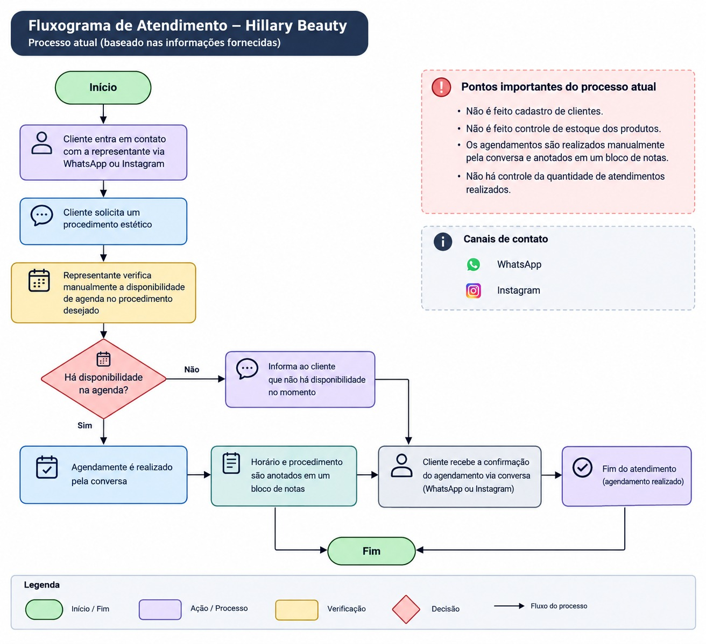
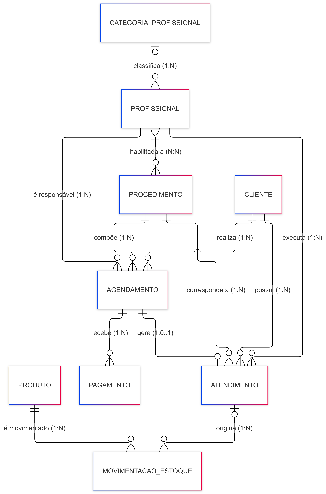
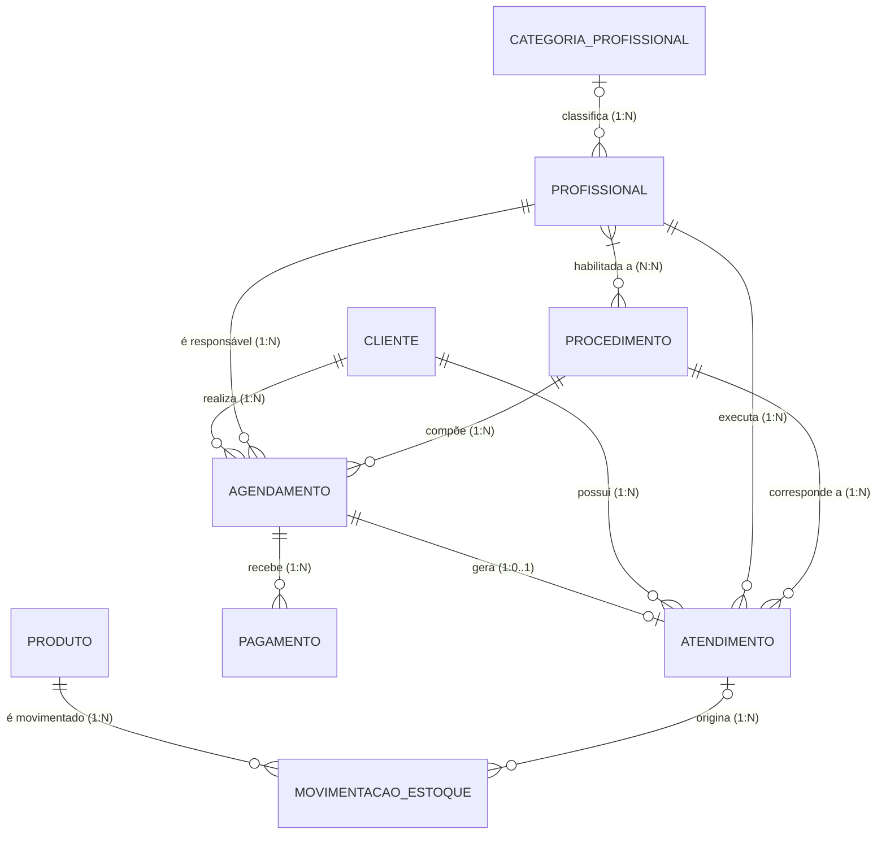
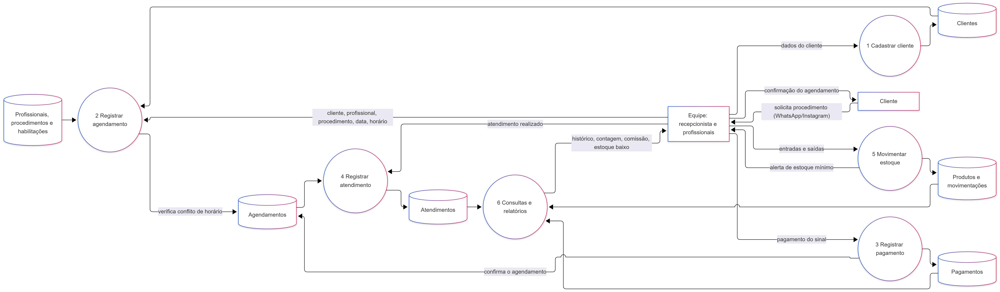
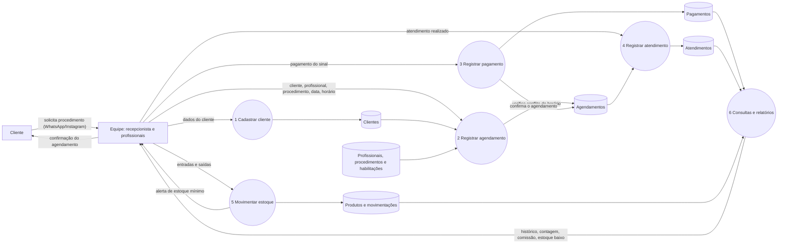

# Hillary Beauty — Modelagem de Banco de Dados

# Integrantes do grupo

|Integrante|RGM|
|-|-|
|Tiago Henrique Stockmann Teixeira| 47039311 |
|Victor Chouzende dos Santos||
|Carlos Eduardo Azevedo Alves||
|Davi Henrique Santos||

## Sobre o Projeto

Este projeto apresenta a **modelagem de um banco de dados para a Hillary Beauty**, um studio de beleza localizado na Rua Nelson de Oliveira, 55, São Paulo — SP, Brasil.
WhatsApp: 11986194148
Instagram: _hillarybeauty

A empresa atua na área de estética e beleza e conta atualmente com **cinco profissionais** responsáveis pela realização dos procedimentos e com uma **recepcionista**.

Atualmente, o processo de atendimento é realizado principalmente por meio de **WhatsApp e Instagram**. Os clientes entram em contato com uma das representantes, solicitam um procedimento, e a profissional verifica manualmente sua disponibilidade de agenda. Quando existe disponibilidade, o agendamento é realizado pela própria conversa e posteriormente anotado em um bloco de notas.

A empresa também não possui atualmente um sistema estruturado para:

* Cadastro de clientes;
* Controle de agendamentos;
* Controle da quantidade de atendimentos;
* Histórico dos atendimentos;
* Cadastro de produtos;
* Controle de estoque;
* Registro de entradas e saídas de produtos;
* Controle da disponibilidade das profissionais;
* Relacionamento entre clientes, profissionais e procedimentos.

Diante desse cenário, este projeto propõe uma estrutura de banco de dados capaz de **centralizar, organizar e preservar essas informações**, reduzindo problemas decorrentes do controle manual.

---

# Objetivo do Projeto

O objetivo principal é desenvolver uma **modelagem de banco de dados estruturada** para apoiar os processos de atendimento, agendamento, cadastro de clientes, controle de profissionais, procedimentos, pagamentos e gerenciamento de estoque da Hillary Beauty.

O banco de dados deverá permitir que as informações sejam armazenadas de forma organizada e relacionadas entre si, possibilitando maior controle sobre as operações realizadas pela empresa.

Entre os principais objetivos estão:

* Centralizar os dados dos clientes;
* Organizar os agendamentos;
* Evitar conflitos de horários;
* Controlar os profissionais responsáveis pelos procedimentos;
* Registrar os atendimentos realizados;
* Registrar o sinal e os pagamentos dos agendamentos;
* Manter o histórico de cada cliente;
* Contabilizar a quantidade de atendimentos;
* Apoiar o cálculo da comissão por categoria de profissional;
* Controlar esmaltes, EPIs e descartáveis em estoque;
* Registrar entradas e saídas do estoque;
* Evitar estoque negativo;
* Identificar produtos próximos ou abaixo do estoque mínimo;
* Garantir maior integridade das informações.

---

# Delimitação do Escopo

Esta entrega contém o **modelo conceitual** do banco de dados (revisado após a avaliação) e o **modelo lógico implementado em PostgreSQL, no Supabase** (seção "Modelo Lógico" e pasta `banco-logico/`). Não fazem parte do escopo:

|Fora do escopo|Motivo|
|-|-|
|Contas a pagar, fluxo de caixa e conciliação financeira|O levantamento tratou do sinal, dos pagamentos dos atendimentos e da comissão por categoria; não tratou de controle financeiro geral|
|Emissão de documentos fiscais (NF-e, NFS-e)|Depende de regras tributárias externas ao funcionamento observado|
|Cadastro de fornecedores e ordens de compra|O levantamento não detalhou o processo de compra; as entradas de estoque são registradas na movimentação, com motivo|
|Interface gráfica e implementação do sistema|O produto desta etapa é o modelo de dados, não o software|
|Perfis de acesso e permissões por usuário|Tratados apenas como requisito não funcional, sem modelagem de entidades|

A entidade `Produto` é modelada como **insumo de consumo geral** (esmaltes, EPIs e descartáveis), e não como mercadoria revendida ao cliente. Os demais materiais usados nos procedimentos não têm controle de estoque na organização.

---

# Contexto da Empresa

**Empresa:** Hillary Beauty  
**Segmento:** Estética e beleza  
**Localização:** Rua Nelson de Oliveira, 55, São Paulo — SP, Brasil  
**Equipe:** 5 profissionais que realizam procedimentos e recepcionista  
**Forma atual de agendamento:** WhatsApp e Instagram  
**Controle atual:** Conversas, agenda manual e bloco de notas  
**Controle de estoque:** Não estruturado em sistema próprio  
**Alvarás:** em processo de obtenção

---

# Levantamento com a Organização

Além da descrição inicial do cenário, o grupo levantou informações diretamente com a Hillary Beauty, que fundamentam as entidades, os atributos e as regras deste documento.

|Registro do contato|Informação|
|-|-|
|Data||
|Forma (visita ou conversa)||
|Pessoa da organização||

**Informações obtidas:**

* **Procedimentos oferecidos:** 22 procedimentos, cada um com valor de referência e intervalo de retorno (Anexo B).
* **Política de agendamento:** o horário só é reservado após o pagamento de um sinal de 40% do valor do procedimento; atrasos acima de 10 minutos podem resultar em cancelamento do atendimento; após a confirmação não é possível trocar ou remanejar o horário; em caso de falta ou desistência sem justificativa, o sinal não é devolvido; a cliente declara ciência dessas regras ao pagar o sinal. A política também pede que clientes evitem acompanhantes, o que não tem efeito sobre o modelo de dados.
* **Remuneração das profissionais:** comissão por categoria de profissional, com percentual definido pela organização para cada categoria (os percentuais não são reproduzidos neste documento).
* **Estoque:** controlado somente para esmaltes, EPIs e descartáveis.
* **Equipe:** além das profissionais que realizam procedimentos, há recepcionista, que não realiza procedimentos estéticos.
* **Alvarás:** em processo de obtenção.

---

# Problema Identificado

Atualmente, os processos da Hillary Beauty são realizados de maneira pouco centralizada.

Os clientes entram em contato pelas redes sociais, principalmente WhatsApp e Instagram, para solicitar um procedimento. A profissional verifica manualmente sua disponibilidade e realiza o agendamento pela própria conversa.

Posteriormente, as informações podem ser anotadas em um bloco de notas, não existindo um banco de dados centralizado para armazenar essas informações.

Esse processo apresenta alguns riscos:

* Conflitos de horários;
* Perda de informações;
* Dificuldade para consultar agendamentos;
* Dificuldade para saber quantos atendimentos foram realizados;
* Falta de histórico organizado dos clientes;
* Ausência de cadastro estruturado dos clientes;
* Dificuldade para identificar os procedimentos realizados;
* Falta de controle sobre os produtos utilizados;
* Falta de controle sobre a quantidade disponível em estoque;
* Possibilidade de utilização de produtos sem controle da quantidade restante.

---

# Motivo da Escolha

A Hillary Beauty foi escolhida por apresentar um cenário real em que a aplicação de um banco de dados estruturado pode contribuir significativamente para a organização dos processos da empresa.

A empresa possui processos de atendimento e gerenciamento de clientes que atualmente são realizados de forma pouco centralizada, principalmente por meio do WhatsApp e Instagram.

A existência de cinco profissionais e a necessidade de realizar atendimentos mediante agendamento e pagamento de sinal tornam importante o controle dos horários disponíveis, dos profissionais responsáveis e dos procedimentos realizados.

Além disso, existe a necessidade de melhorar o controle dos produtos de consumo e do estoque disponível.

A ausência de um sistema centralizado pode ocasionar conflitos de horários, perda de informações, dificuldade na consulta do histórico dos clientes e falta de controle sobre a quantidade de produtos disponíveis.

Dessa forma, a modelagem proposta busca representar e relacionar informações sobre **clientes, profissionais, procedimentos, agendamentos, atendimentos, pagamentos, produtos e movimentações de estoque**, proporcionando uma visão mais organizada das atividades realizadas pela empresa.

---

# Processo Atual do Negócio



O processo atualmente ocorre da seguinte maneira:

```text
Cliente
   ↓
Contato pelo WhatsApp ou Instagram
   ↓
Solicitação de procedimento
   ↓
Profissional verifica manualmente a agenda
   ↓
Verificação da disponibilidade
   ↓
Existe disponibilidade?
   ├── NÃO → Cliente recebe outra opção de horário
   │
   └── SIM
         ↓
      Agendamento pela conversa
         ↓
      Pagamento do sinal (40% do valor do procedimento)
         ↓
      Horário reservado após a confirmação do pagamento
         ↓
      Anotação manual em bloco de notas
         ↓
      Realização do procedimento
```

O estoque segue um processo separado e sem controle estruturado:

```text
Produto utilizado
      ↓
Utilização no procedimento
      ↓
Não existe baixa automática
      ↓
Quantidade disponível não é atualizada
      ↓
Dificuldade para identificar estoque atual
```

---

# Modelo Conceitual Proposto

O banco de dados será composto pelas seguintes entidades:

1. **Cliente**
2. **Profissional**
3. **Categoria_Profissional**
4. **Procedimento**
5. **Agendamento**
6. **Atendimento**
7. **Pagamento**
8. **Produto**
9. **Movimentação de Estoque**

Além dessas entidades, existe um relacionamento N:N entre **Profissional** e **Procedimento** ("habilitada a"), que representa quais procedimentos cada profissional pode realizar. Ele evita armazenar vários procedimentos em um único atributo da profissional e, no modelo lógico, será implementado por uma tabela de ligação.

---

# Dicionário de Dados Conceitual

As tabelas a seguir descrevem, para cada entidade do modelo, os atributos identificados, sua descrição, a regra de negócio associada e o motivo pelo qual o atributo é necessário.

Os valores citados como exemplo são **fictícios**. Nenhum dado real de cliente, profissional ou fornecedor da organização é reproduzido neste documento.

## Convenções do dicionário

|Item|Convenção|
|-|-|
|SGBD adotado|PostgreSQL, hospedado no Supabase|
|Versão do dicionário|3.0 (inclui o modelo lógico)|
|Codificação e collation|UTF-8; collation pt_BR|
|Nomes|minúsculas, sem acentos, palavras separadas por `_`, entidades no singular|
|Prefixos e sufixos|`id_` para identificadores; `data_` para datas; `horario_` para horas; `status_` para situações; `tipo_` para classificações|
|Notação|Chen/pé de galinha no DER; atributos identificadores marcados como PK na expressão formal|
|Obrigatoriedade|"Obrigatório" = não pode ser nulo; "Opcional" = pode ser nulo|

## 1. Cliente

A entidade `Cliente` representa as pessoas que utilizam os serviços oferecidos pela Hillary Beauty.

|Atributo|Descrição|Regra|Motivo da obrigatoriedade|
|-|-|-|-|
|`id_cliente`|Identificador único do cliente|Único e obrigatório|Necessário para identificar o cliente de forma única e manter a integridade dos relacionamentos no banco de dados.|
|`nome`|Nome completo do cliente|Obrigatório|Necessário para identificar corretamente o cliente nos cadastros, agendamentos e histórico de atendimentos.|
|`telefone`|Número utilizado para contato|Obrigatório|Necessário para permitir a identificação e o contato com o cliente para fins de atendimento e agendamento.|
|`data_nascimento`|Data de nascimento|Opcional; deve ser data válida e anterior à data atual|Opcional. Apoia a identificação de clientes homônimos e o relacionamento com o cliente.|
|`data_cadastro`|Data de cadastro|Registrada automaticamente pelo sistema|Permite saber há quanto tempo o cliente é atendido e ordenar a base por antiguidade.|
|`status_cliente`|Situação do cadastro|Ativo ou Inativo|Permite inativar o cadastro sem excluí-lo, preservando o histórico de atendimentos já realizados.|

**Regra relacionada:** um cliente deverá estar previamente cadastrado para realizar ou agendar um procedimento.

## 2. Profissional

A entidade `Profissional` representa as pessoas da equipe da Hillary Beauty: as cinco profissionais que realizam procedimentos e a recepcionista, que não realiza procedimentos.

|Atributo|Descrição|Regra|Motivo da obrigatoriedade|
|-|-|-|-|
|`id_profissional`|Identificador único|Único e obrigatório|Necessário para identificar a pessoa de forma única e manter a integridade dos relacionamentos no banco de dados.|
|`nome`|Nome da pessoa|Obrigatório|Necessário para identificar corretamente a responsável por agendamentos e atendimentos.|
|`telefone`|Telefone|Opcional; deve ser válido quando informado|Opcional. Utilizado para contato interno; não é necessário para identificar a pessoa.|
|`status_profissional`|Situação profissional|Ativa ou Inativa|Impede que profissionais desligadas recebam novos agendamentos, sem apagar os atendimentos que já realizaram.|
|`especialidade`|Área de atuação|Opcional; rótulo descritivo, em texto livre|Descreve a área em que a profissional atua. O controle operacional de **quais procedimentos** ela pode executar é feito pelo relacionamento "habilitada a", e não por este atributo. É opcional porque a recepcionista não atua em procedimentos.|

**Regras relacionadas:** uma profissional somente poderá receber um agendamento para procedimentos que esteja habilitada a realizar; por isso, quem não possui habilitação (como a recepcionista) não recebe agendamentos. Profissionais inativas não poderão receber novos agendamentos.

## 3. Categoria_Profissional

A entidade `Categoria_Profissional` representa as categorias usadas pela organização para definir o percentual de comissão de cada profissional.

|Atributo|Descrição|Regra|Motivo da obrigatoriedade|
|-|-|-|-|
|`id_categoria`|Identificador único|Único e obrigatório|Necessário para identificar a categoria e relacioná-la às profissionais.|
|`nome`|Nome da categoria|Obrigatório|Necessário para identificar a categoria.|
|`percentual_comissao`|Percentual de comissão da categoria|Obrigatório; entre 0 e 100|Necessário para apurar a comissão. O percentual depende da categoria, e não de cada profissional; por isso fica nesta entidade, sem repetição.|

**Regra relacionada:** a comissão não é armazenada: é apurada pelo percentual da categoria sobre o valor cobrado dos atendimentos realizados pela profissional.

## 4. Procedimento

A entidade `Procedimento` representa os serviços estéticos e de beleza oferecidos pela empresa.

|Atributo|Descrição|Regra|Motivo da obrigatoriedade|
|-|-|-|-|
|`id_procedimento`|Identificador único|Único e obrigatório|Necessário para identificar o procedimento de forma única e manter a integridade dos relacionamentos no banco de dados.|
|`nome`|Nome do procedimento|Obrigatório|Necessário para identificar corretamente o serviço oferecido e permitir sua utilização nos agendamentos e atendimentos.|
|`descricao`|Descrição do procedimento|Opcional|Opcional. Detalha o que o serviço inclui, sem impacto sobre as regras do sistema.|
|`duracao`|Tempo estimado do procedimento|Obrigatório|Necessário para calcular o horário de término e verificar conflitos de agenda.|
|`valor`|Valor de referência ("a partir de")|Maior ou igual a zero|Necessário para informar o preço de referência ao cliente e calcular o sinal. Alguns procedimentos têm preço variável (por área, região ou sessão); o valor efetivamente cobrado fica registrado em `Pagamento`.|
|`intervalo_retorno`|Intervalo recomendado entre sessões ou retorno|Opcional; texto descritivo (ex.: "35 dias", "depende de avaliação")|Opcional. Apoia o retorno do cliente; em alguns procedimentos o intervalo depende de avaliação e não pode ser padronizado.|
|`status_procedimento`|Situação do procedimento|Ativo ou Inativo|Impede que procedimentos descontinuados sejam agendados, preservando os atendimentos já realizados com eles.|

**Regras relacionadas:** o procedimento deverá estar cadastrado e ativo para poder ser agendado. A duração será utilizada para determinar o horário de término do agendamento.

## 5. Agendamento

A entidade `Agendamento` representa a reserva de um horário para que determinado cliente realize um procedimento com uma profissional.

|Atributo|Descrição|Regra|Motivo da obrigatoriedade|
|-|-|-|-|
|`id_agendamento`|Identificador único|Único e obrigatório|Necessário para identificar cada agendamento de forma única e manter seus relacionamentos no banco de dados.|
|`id_cliente`|Cliente relacionado|Obrigatório|Necessário para identificar quem realizará o procedimento e manter o vínculo do agendamento com o cliente.|
|`id_profissional`|Profissional responsável|Obrigatório|Necessário para identificar quem realizará o procedimento e verificar sua disponibilidade e habilitação.|
|`id_procedimento`|Procedimento solicitado|Obrigatório|Necessário para identificar qual serviço será realizado e determinar sua duração e demais regras.|
|`data_agendamento`|Data do procedimento|Obrigatória|Necessária para definir quando o procedimento ocorrerá e permitir o controle da agenda.|
|`horario_inicio`|Horário de início|Obrigatório|Necessário para reservar o período correto na agenda e evitar conflitos de horários.|
|`horario_fim`|Horário de término|Determinado pelo horário de início somado à duração do procedimento|Necessário para verificar conflitos considerando o intervalo inteiro do procedimento, e não apenas o horário de início.|
|`status_agendamento`|Situação do agendamento|Agendado, Confirmado, Realizado, Cancelado ou Não Compareceu|Distingue o que aguarda o sinal (Agendado), o que está com o horário reservado após o pagamento do sinal (Confirmado), o que foi realizado e o que foi cancelado ou não ocorreu.|
|`observacao`|Informações adicionais|Opcional|Opcional. Registra informações pontuais combinadas com o cliente no momento do agendamento.|

**Regras relacionadas:**

* O cliente deve estar cadastrado.
* A profissional deve estar ativa e habilitada para o procedimento.
* O procedimento deve estar ativo.
* A profissional deve estar disponível e não podem existir horários conflitantes.
* O horário só é reservado após a confirmação do pagamento do sinal.
* Após a confirmação, não é possível trocar ou remanejar o horário.
* Cancelamentos devem liberar o horário.

## 6. Atendimento

A entidade `Atendimento` representa um procedimento que foi efetivamente realizado.

|Atributo|Descrição|Regra|Motivo da obrigatoriedade|
|-|-|-|-|
|`id_atendimento`|Identificador único|Único e obrigatório|Necessário para identificar cada atendimento de forma única e manter seu histórico e relacionamentos.|
|`id_agendamento`|Agendamento relacionado|Obrigatório|Necessário para comprovar a origem do atendimento e garantir que ele esteja vinculado a um agendamento existente.|
|`id_cliente`|Cliente atendido|Deve corresponder ao cliente do agendamento de origem|Registra de forma definitiva quem foi atendido, preservando o histórico mesmo diante de alterações posteriores no agendamento.|
|`id_profissional`|Profissional responsável|Deve corresponder à profissional do agendamento de origem|Registra de forma definitiva quem executou o procedimento, servindo de base para a contabilização de atendimentos por profissional.|
|`id_procedimento`|Procedimento realizado|Deve corresponder ao procedimento do agendamento de origem|Registra de forma definitiva qual serviço foi prestado, servindo de base para a contabilização de atendimentos por procedimento.|
|`data_atendimento`|Data do atendimento|Obrigatória|Necessária para registrar quando o serviço foi efetivamente realizado e manter o histórico cronológico.|
|`horario_atendimento`|Horário do atendimento|Compatível com o agendamento|Registra o horário em que o procedimento efetivamente ocorreu, que pode diferir do horário originalmente reservado.|
|`observacao`|Observações do atendimento|Opcional|Opcional. Registra observações sobre a execução do procedimento.|

**Regras relacionadas:** um atendimento somente poderá ser registrado quando existir um agendamento correspondente. Os atendimentos realizados deverão permanecer registrados para formar o histórico do cliente. Somente atendimentos efetivamente realizados deverão ser contabilizados.

## 7. Pagamento

A entidade `Pagamento` representa os valores pagos referentes a um agendamento, a começar pelo sinal exigido para reservar o horário.

|Atributo|Descrição|Regra|Motivo da obrigatoriedade|
|-|-|-|-|
|`id_pagamento`|Identificador único|Único e obrigatório|Necessário para identificar cada pagamento de forma única e preservar seu histórico.|
|`id_agendamento`|Agendamento relacionado|Obrigatório|O sinal é pago antes de existir atendimento; por isso o pagamento se vincula ao agendamento.|
|`valor`|Valor pago|Estritamente maior que zero|Necessário para registrar quanto foi pago e apurar o valor cobrado do atendimento.|
|`data_pagamento`|Data do pagamento|Obrigatória|Necessária para registrar quando o pagamento ocorreu e confirmar o agendamento.|
|`tipo_pagamento`|Tipo do pagamento|Sinal ou Restante|Distingue o sinal, que confirma o agendamento, do pagamento do saldo.|

**Regras relacionadas:** o sinal corresponde a 40% do valor do procedimento. O agendamento só passa a Confirmado após o pagamento do sinal. Em falta ou desistência sem justificativa, o sinal não é devolvido.

## 8. Produto

A entidade `Produto` representa os itens de consumo controlados em estoque: esmaltes, EPIs e descartáveis.

|Atributo|Descrição|Regra|Motivo da obrigatoriedade|
|-|-|-|-|
|`id_produto`|Identificador único|Único e obrigatório|Necessário para identificar o produto de forma única e manter a integridade das movimentações de estoque.|
|`nome`|Nome do produto|Obrigatório|Necessário para identificar corretamente o produto e permitir seu controle no estoque.|
|`descricao`|Características do produto|Opcional|Opcional. Detalha marca, volume ou composição do produto.|
|`unidade_medida`|Unidade de controle|Valores controlados: unidade, ml, g|Necessário para que a quantidade em estoque tenha significado e para que as movimentações sejam comparáveis entre si.|
|`quantidade_atual`|Quantidade disponível|Nunca pode ser negativa; resulta das entradas menos as saídas|Necessário para consultar o saldo disponível e sinalizar reposição sem recalcular todas as movimentações a cada consulta.|
|`estoque_minimo`|Limite mínimo|Maior ou igual a zero|Necessário para definir o limite a partir do qual o sistema sinaliza a necessidade de reposição.|
|`status_produto`|Situação do produto|Ativo ou Inativo|Impede que produtos descontinuados recebam novas saídas, preservando as movimentações já registradas.|

**Regras relacionadas:** o produto deverá estar cadastrado; a quantidade nunca poderá ser negativa; produtos inativos não receberão novas saídas; o sistema deverá sinalizar produtos abaixo ou no estoque mínimo.

## 9. Movimentação de Estoque

A entidade `Movimentacao_Estoque` representa as entradas e saídas dos produtos. O consumo é geral, isto é, a saída não precisa estar vinculada a um atendimento.

|Atributo|Descrição|Regra|Motivo da obrigatoriedade|
|-|-|-|-|
|`id_movimentacao`|Identificador único|Único e obrigatório|Necessário para identificar cada movimentação de estoque de forma única e preservar seu histórico.|
|`id_produto`|Produto movimentado|Obrigatório|Necessário para identificar qual produto teve sua quantidade alterada e manter a integridade do estoque.|
|`tipo_movimentacao`|Entrada ou saída|Valores controlados: Entrada ou Saída|Necessário para determinar se a quantidade disponível será somada ou subtraída.|
|`quantidade`|Quantidade movimentada|Estritamente maior que zero|Necessário para calcular a alteração do saldo; uma movimentação de quantidade zero não altera o estoque.|
|`data_movimentacao`|Data da movimentação|Obrigatória|Necessária para registrar quando a alteração de estoque ocorreu e manter o histórico das movimentações.|
|`motivo`|Justificativa da movimentação|Obrigatório nas entradas e nas saídas não ligadas a atendimento|Justifica movimentações como compras, consumo geral, perdas e vencimentos.|
|`id_atendimento`|Atendimento relacionado|Opcional|Opcional. Permite rastrear a saída ao atendimento quando o consumo puder ser atribuído a um.|

**Regras relacionadas:** uma entrada aumenta a quantidade disponível; uma saída reduz a quantidade disponível; uma saída somente pode ocorrer quando houver quantidade suficiente em estoque.

---

# Relacionamentos e Cardinalidades

As cardinalidades indicam, para cada entidade, **(mínimo, máximo)** de vezes em que uma ocorrência dela participa do relacionamento.

|Relacionamento|Cardinalidade|Entidade A|Entidade B|Leitura|
|-|-|-|-|-|
|realiza|1:N|Cliente (0,N)|Agendamento (1,1)|Um cliente realiza zero ou vários agendamentos; cada agendamento pertence a exatamente um cliente.|
|é responsável|1:N|Profissional (0,N)|Agendamento (1,1)|Cada agendamento tem exatamente uma profissional responsável.|
|compõe|1:N|Procedimento (0,N)|Agendamento (1,1)|Cada agendamento corresponde a exatamente um procedimento.|
|gera|1:0..1|Agendamento (0,1)|Atendimento (1,1)|Um agendamento gera no máximo um atendimento (cancelamentos e não comparecimentos não geram); todo atendimento vem de exatamente um agendamento.|
|recebe|1:N|Agendamento (0,N)|Pagamento (1,1)|Um agendamento recebe zero ou vários pagamentos (zero enquanto aguarda o sinal); cada pagamento pertence a exatamente um agendamento.|
|possui|1:N|Cliente (0,N)|Atendimento (1,1)|Cada atendimento pertence a exatamente um cliente.|
|executa|1:N|Profissional (0,N)|Atendimento (1,1)|Cada atendimento tem exatamente uma profissional responsável.|
|corresponde a|1:N|Procedimento (0,N)|Atendimento (1,1)|Cada atendimento corresponde a exatamente um procedimento.|
|é movimentado|1:N|Produto (0,N)|Movimentação (1,1)|Cada movimentação pertence a exatamente um produto.|
|origina|1:N|Atendimento (0,N)|Movimentação (0,1)|Uma movimentação pode, ou não, estar ligada a um atendimento (entradas e consumo geral não estão).|
|habilitada a|N:N|Profissional (0,N)|Procedimento (1,N)|Uma profissional pode estar habilitada a vários procedimentos (a recepcionista, a nenhum); todo procedimento tem ao menos uma profissional habilitada. Relacionamento N:N.|
|classifica|1:N|Categoria_Profissional (0,N)|Profissional (0,1)|Cada profissional pertence a no máximo uma categoria de comissão.|

---

# Resumo das Entidades

|Entidade|Finalidade|
|-|-|
|**Cliente**|Armazenar os dados e informações dos clientes|
|**Profissional**|Controlar a equipe (profissionais e recepcionista) e seus dados|
|**Categoria_Profissional**|Definir o percentual de comissão por categoria|
|**Procedimento**|Cadastrar os serviços oferecidos|
|**Agendamento**|Controlar datas, horários, clientes, profissionais e procedimentos|
|**Atendimento**|Registrar os procedimentos efetivamente realizados|
|**Pagamento**|Registrar o sinal e os pagamentos dos agendamentos|
|**Produto**|Cadastrar e acompanhar esmaltes, EPIs e descartáveis|
|**Movimentação_Estoque**|Registrar entradas e saídas dos produtos|

O relacionamento N:N **habilitada a** controla quais procedimentos cada profissional pode realizar.

---

# Requisitos do Sistema

## 1. Cadastro de Clientes

O sistema deverá permitir cadastrar, consultar, alterar e inativar clientes, armazenando nome, telefone, data de nascimento, data de cadastro, status e histórico de atendimentos.

## 2. Gerenciamento de Agendamentos

O sistema deverá permitir realizar agendamentos informando cliente, procedimento, profissional, data e horário, verificar automaticamente a disponibilidade da profissional e impedir conflitos de horários.

## 3. Controle de Atendimentos e Pagamentos

O sistema deverá registrar cada atendimento realizado, relacionando cliente, profissional, procedimento, agendamento, data e horário, permitir consultar o histórico e a quantidade de atendimentos, e registrar o sinal e os demais pagamentos dos agendamentos.

## 4. Controle de Estoque

O sistema deverá permitir cadastrar produtos, registrar entradas e saídas, atualizar automaticamente a quantidade disponível, identificar estoque baixo e impedir estoque negativo.

---

# Requisitos Funcionais

### RF01 — Cadastro de clientes

O sistema deve permitir cadastrar, consultar, alterar e inativar clientes, armazenando seus dados pessoais e informações de contato.

### RF02 — Gerenciamento de agendamentos

O sistema deve permitir registrar um agendamento informando cliente, procedimento, profissional, data e horário, verificando automaticamente a disponibilidade da agenda.

### RF03 — Registro de atendimentos

O sistema deve permitir registrar um atendimento realizado, vinculando o cliente, profissional, procedimento e agendamento, mantendo um histórico dos atendimentos.

### RF04 — Controle de estoque

O sistema deve permitir cadastrar produtos e registrar suas entradas e saídas, atualizando automaticamente a quantidade disponível em estoque.

### RF05 — Cadastro de profissionais

O sistema deve permitir cadastrar, consultar, alterar e inativar profissionais, armazenando nome, telefone, especialidade, categoria e situação.

### RF06 — Habilitação de procedimentos por profissional

O sistema deve permitir registrar e consultar quais procedimentos cada profissional está habilitada a executar.

### RF07 — Cadastro de procedimentos

O sistema deve permitir cadastrar, consultar, alterar e inativar procedimentos, armazenando nome, descrição, duração, valor de referência, intervalo de retorno e situação.

### RF08 — Verificação de conflito de horários

O sistema deve impedir o registro de um agendamento cuja profissional já possua outro agendamento no mesmo intervalo, considerando o horário de início e o horário de término.

### RF09 — Validação de profissional habilitada

O sistema deve impedir o agendamento de um procedimento para o qual a profissional selecionada não esteja habilitada.

### RF10 — Cancelamento de agendamento

O sistema deve permitir cancelar um agendamento, liberando o horário da profissional. Após a confirmação do agendamento, o sistema não deve permitir a troca ou o remanejamento de data ou horário.

### RF11 — Impedimento de estoque negativo

O sistema deve impedir o registro de uma saída de estoque cuja quantidade seja superior à quantidade disponível do produto.

### RF12 — Alerta de estoque mínimo

O sistema deve sinalizar os produtos cuja quantidade atual esteja igual ou abaixo do estoque mínimo definido.

### RF13 — Consultas e contabilização de atendimentos

O sistema deve permitir consultar a quantidade de atendimentos realizados por cliente, profissional, procedimento e período, considerando somente os atendimentos efetivamente registrados.

### RF14 — Registro de pagamentos e confirmação do agendamento

O sistema deve permitir registrar os pagamentos de um agendamento, e confirmar o agendamento somente após o registro do pagamento do sinal.

### RF15 — Apuração de comissão

O sistema deve permitir consultar a comissão devida a cada profissional por período, aplicando o percentual da sua categoria ao valor cobrado dos atendimentos realizados.

---

# Requisitos Não Funcionais

## RNF01 — Desempenho

O sistema deve responder às consultas e operações realizadas pelo usuário em até **3 segundos**, mesmo durante o acesso simultâneo de diferentes profissionais.

## RNF02 — Segurança

O sistema deve proteger os dados dos clientes e usuários por meio de autenticação com login e senha.

Somente usuários autorizados deverão ter acesso às informações do sistema.

## RNF03 — Usabilidade

O sistema deve possuir uma interface simples, intuitiva e responsiva.

As profissionais devem conseguir realizar cadastros, agendamentos, registros de atendimentos e consultas de estoque de maneira rápida e fácil.

## RNF04 — Disponibilidade e Integridade

O sistema deve estar disponível durante o horário de funcionamento da Hillary Beauty.

Os dados devem ser armazenados de maneira segura, evitando perda ou inconsistência das informações.

## RNF05 — Conformidade com a LGPD

O sistema trata dados pessoais de clientes (nome, telefone e data de nascimento), enquadrando-se na Lei nº 13.709/2018 (Lei Geral de Proteção de Dados Pessoais).

O acesso a esses dados deve ser restrito às profissionais autorizadas, com finalidade limitada ao atendimento e ao agendamento. O sistema deve prever a inativação do cadastro em vez da exclusão física, preservando o histórico, e deve permitir o atendimento a pedidos de exclusão feitos pelo próprio titular dos dados. Os detalhes estão na seção "LGPD no Dicionário de Dados".

---

# Regras de Negócio

## Cadastro de Clientes

Todo cliente que realizar ou agendar um procedimento deverá estar previamente cadastrado no sistema.

O cadastro deverá conter, no mínimo: nome e telefone. A data de nascimento é opcional.

## Cadastro de Profissionais

Cada pessoa da equipe deverá possuir um cadastro individual.

O sistema deverá manter informações de identificação, a categoria de comissão e os procedimentos que a profissional está habilitada a realizar. A recepcionista não realiza procedimentos e, por isso, não possui habilitações.

## Cadastro de Procedimentos

Todo procedimento oferecido pela empresa deverá estar cadastrado, com nome, descrição, duração, valor de referência, intervalo de retorno e status. Todo procedimento deve ter ao menos uma profissional habilitada.

## Agendamento

Todo agendamento deverá estar obrigatoriamente vinculado a um cliente, uma profissional, um procedimento, uma data e um horário.

## Reserva de Horário e Sinal

Para confirmar o agendamento é necessário o pagamento de um sinal correspondente a 40% do valor do procedimento. O horário só é reservado após a confirmação do pagamento.

## Disponibilidade da Profissional

Uma profissional não poderá possuir dois agendamentos conflitantes no mesmo período.

O sistema deverá verificar automaticamente a disponibilidade antes de confirmar um novo agendamento.

## Profissional Habilitada

Um procedimento somente poderá ser agendado com uma profissional que esteja habilitada a realizá-lo.

## Status do Agendamento

Todo agendamento deverá possuir um status: Agendado (aguardando o sinal), Confirmado (sinal pago), Realizado, Cancelado ou Não Compareceu.

## Pontualidade

Atrasos superiores a 10 minutos poderão resultar no cancelamento do atendimento.

## Troca e Remanejamento

Após a confirmação, não é possível trocar ou remanejar o horário agendado. Quem precisar de outro horário deve cancelar e realizar um novo agendamento.

## Faltas e Cancelamentos

Em caso de não comparecimento sem justificativa ou desistência, o sinal não será devolvido.

## Registro do Atendimento

Um atendimento somente poderá ser registrado como realizado quando estiver relacionado a um agendamento existente.

## Histórico do Cliente

Todos os atendimentos realizados deverão permanecer registrados no histórico do cliente, permitindo consultar procedimentos realizados, datas, horários e profissionais responsáveis.

## Contabilização dos Atendimentos

O sistema deverá permitir contabilizar a quantidade de atendimentos realizados por cliente, profissional, procedimento, período e empresa. Somente atendimentos efetivamente realizados deverão ser contabilizados.

## Comissão

A comissão de cada profissional é apurada pelo percentual da categoria sobre o valor cobrado dos atendimentos que realizou. Ela não é armazenada, apenas calculada.

## Cadastro de Produtos

Todo produto controlado em estoque (esmaltes, EPIs e descartáveis) deverá possuir cadastro, com nome, descrição, unidade de medida, quantidade disponível, estoque mínimo e status.

## Entrada e Saída de Produtos

Toda entrada e toda saída de produto deverá ser registrada, ajustando automaticamente a quantidade disponível. O consumo é geral: a saída não precisa estar vinculada a um atendimento.

## Estoque Negativo

O sistema não poderá permitir que a quantidade disponível de um produto fique abaixo de zero.

## Estoque Mínimo

Cada produto poderá possuir uma quantidade mínima definida. Quando o estoque atingir ou ficar abaixo desse limite, o sistema deverá sinalizar a necessidade de reposição.

## Cancelamento

Quando um agendamento for cancelado, o horário da profissional deverá ficar disponível novamente. Um agendamento cancelado não poderá posteriormente ser registrado como atendimento realizado.

## Conformidade Legal

O tratamento dos dados pessoais deve seguir a LGPD (Lei nº 13.709/2018). A organização está em processo de obtenção dos alvarás de funcionamento; o sistema não modela os alvarás.

## Integridade dos Registros

O sistema deverá manter os relacionamentos entre clientes, profissionais, procedimentos, agendamentos, atendimentos, pagamentos, produtos e movimentações de estoque. Não deverão existir registros sem as informações necessárias para manter a integridade do banco.

---

# Regras Operacionais

### RO01 — Cadastro obrigatório do cliente
Um agendamento só poderá ser realizado se o cliente estiver previamente cadastrado.

### RO02 — Agendamento condicionado à disponibilidade
Um procedimento somente poderá ser agendado se a profissional responsável estiver disponível na data e horário solicitados.

### RO03 — Impedimento de conflito de horários
Uma profissional não poderá possuir dois agendamentos conflitantes.

### RO04 — Profissional habilitada
Um procedimento somente poderá ser agendado com uma profissional habilitada.

### RO05 — Dados obrigatórios
Um agendamento somente poderá ser confirmado quando possuir cliente, profissional, procedimento, data, horário e o pagamento do sinal.

### RO06 — Registro do atendimento
Um atendimento somente poderá ser registrado após existir um agendamento correspondente.

### RO07 — Histórico de atendimento
Todo atendimento realizado deverá ser registrado no histórico do respectivo cliente.

### RO08 — Troca de horário não permitida
Após a confirmação do agendamento, não é permitido trocar ou remanejar data ou horário.

### RO09 — Cancelamento
Um agendamento cancelado não poderá ser registrado como atendimento realizado e deverá liberar o horário da profissional.

### RO10 — Registro de produtos
Um produto somente poderá ser utilizado no controle de estoque se estiver previamente cadastrado.

### RO11 — Saída de estoque
A utilização de um produto deverá gerar uma saída correspondente no estoque, com motivo, podendo ou não estar vinculada a um atendimento.

### RO12 — Disponibilidade de estoque
Um produto somente poderá ser utilizado se houver quantidade suficiente disponível.

### RO13 — Proibição de estoque negativo
Uma saída não poderá ser registrada quando a quantidade solicitada for superior à quantidade disponível.

### RO14 — Entrada de estoque
Uma entrada deverá aumentar automaticamente a quantidade disponível.

### RO15 — Alerta de estoque baixo
Quando a quantidade atingir ou ficar abaixo do estoque mínimo, o sistema deverá sinalizar a necessidade de reposição.

### RO16 — Contabilização
Somente atendimentos registrados como realizados deverão ser contabilizados.

### RO17 — Responsabilidade pelo atendimento
Cada atendimento deverá estar associado a uma única profissional responsável.

### RO18 — Integridade das informações
Um registro não deverá ser excluído caso sua exclusão provoque perda de informações necessárias para manter o histórico de agendamentos, atendimentos, pagamentos ou movimentações de estoque.

### RO19 — Sinal para reservar o horário
O agendamento só é confirmado, e o horário reservado, após o pagamento do sinal de 40% do valor do procedimento.

### RO20 — Atraso
Atrasos superiores a 10 minutos poderão resultar no cancelamento do atendimento.

### RO21 — Sinal em faltas e desistências
Em não comparecimento sem justificativa ou desistência, o sinal não é devolvido.

### RO22 — Comissão por categoria
A comissão é apurada com o percentual da categoria da profissional, sem ser armazenada.

As regras RO23 a RO26 foram definidas durante o modelo lógico (ver seção "Modelo Lógico").

### RO23 — Horário da cliente
Uma cliente não pode ter dois horários reservados (agendamentos confirmados) sobrepostos, mesmo com profissionais diferentes.

### RO24 — Início do agendamento
Todo agendamento é criado como Agendado e só passa a Confirmado após o pagamento do sinal.

### RO25 — Estados finais
Um agendamento Cancelado ou Não Compareceu não é reativado. Para outro horário, cria-se um novo agendamento.

### RO26 — Movimentações imutáveis
Uma movimentação de estoque registrada não é alterada nem excluída. Para corrigir um lançamento, registra-se uma movimentação contrária.

---

# Diagrama Entidade-Relacionamento (DER)

O diagrama utiliza a notação de pé de galinha (crow's foot), que representa a cardinalidade **mínima e máxima** nos dois lados de cada relacionamento. Os símbolos ao lado de uma entidade indicam quantas ocorrências dela se relacionam com uma ocorrência da outra entidade: `||` exatamente um; `|o` zero ou um; `o{` zero ou muitos; `}|` um ou muitos.



<details>
<summary>Código-fonte do DER (Mermaid)</summary>



</details>

Por se tratar de modelo conceitual, as chaves estrangeiras não aparecem como atributos: elas estão representadas pelas próprias linhas de relacionamento e são detalhadas no Apêndice A. Os atributos de cada entidade estão no Dicionário de Dados.

---

# Fluxo de Dados

O fluxo abaixo mostra como os dados circulam no sistema proposto, a partir dos requisitos funcionais. O contato com o cliente continua pelos canais atuais; a equipe registra as informações no sistema.



<details>
<summary>Código-fonte do fluxo de dados (Mermaid)</summary>



</details>

---

# Expressão Formal e Tipos (propostos)

Notação: **PK** em negrito; `→` indica chave estrangeira; `[opc]` indica atributo opcional. Os tipos são **propostos para PostgreSQL** e serão refinados no modelo lógico. A duração é guardada em minutos.

```text
Cliente(id_cliente: integer, nome: varchar, telefone: varchar, data_nascimento: date [opc], data_cadastro: date, status_cliente: varchar)
Categoria_Profissional(id_categoria: integer, nome: varchar, percentual_comissao: numeric(5,2))
Profissional(id_profissional: integer, nome: varchar, telefone: varchar [opc], status_profissional: varchar, especialidade: varchar [opc], id_categoria → Categoria_Profissional [opc])
Procedimento(id_procedimento: integer, nome: varchar, descricao: text [opc], duracao: integer, valor: numeric(10,2), intervalo_retorno: varchar [opc], status_procedimento: varchar)
Profissional_Procedimento(id_profissional → Profissional, id_procedimento → Procedimento)   PK composta
Agendamento(id_agendamento: integer, id_cliente → Cliente, id_profissional → Profissional, id_procedimento → Procedimento, data_agendamento: date, horario_inicio: time, horario_fim: time, status_agendamento: varchar, observacao: text [opc])
Atendimento(id_atendimento: integer, id_agendamento → Agendamento (único), id_cliente → Cliente, id_profissional → Profissional, id_procedimento → Procedimento, data_atendimento: date, horario_atendimento: time, observacao: text [opc])
Pagamento(id_pagamento: integer, id_agendamento → Agendamento, valor: numeric(10,2), data_pagamento: date, tipo_pagamento: varchar)
Produto(id_produto: integer, nome: varchar, descricao: text [opc], unidade_medida: varchar, quantidade_atual: numeric, estoque_minimo: numeric, status_produto: varchar)
Movimentacao_Estoque(id_movimentacao: integer, id_produto → Produto, tipo_movimentacao: varchar, quantidade: numeric, data_movimentacao: date, motivo: varchar [cond.], id_atendimento → Atendimento [opc])
```

PK de cada relação: `id_` da própria entidade (exceto `Profissional_Procedimento`, com PK composta).

---

# Índices (propostos)

|Índice|Finalidade|
|-|-|
|PK de cada entidade|Identificação única (índice criado automaticamente)|
|`Cliente(telefone)` e `Cliente(nome)`|Localizar o cliente a partir do contato recebido|
|`Agendamento(id_profissional, data_agendamento, horario_inicio)`|Verificação de conflito de horários (RF08) e consulta da agenda|
|Restrição de exclusão sobre o intervalo (profissional, data, início–fim) em agendamentos com horário reservado (Confirmado ou Realizado)|Impedir conflitos de horário diretamente no banco|
|Restrição de exclusão sobre o intervalo (cliente, data, início–fim) em agendamentos com horário reservado|Impedir que a mesma cliente tenha dois horários reservados ao mesmo tempo|
|`Agendamento(id_cliente)`|Consulta dos agendamentos de um cliente|
|`Atendimento(id_agendamento)` único|Garantir a cardinalidade 0..1 entre agendamento e atendimento|
|`Atendimento(id_cliente, data_atendimento)`|Histórico do cliente|
|`Atendimento(id_profissional, data_atendimento)`|Contagem de atendimentos e comissão por profissional e período|
|`Pagamento(id_agendamento)`|Consulta dos pagamentos de um agendamento e confirmação do sinal|
|`Movimentacao_Estoque(id_produto, data_movimentacao)`|Histórico de movimentações por produto|
|`Profissional_Procedimento(id_procedimento)`|Consulta inversa: quem realiza cada procedimento|
|`Log_Auditoria(tabela, id_registro)` e `Log_Auditoria(data_hora)`|Histórico de alterações de um registro e consulta do log por período|

---

# Log

O sistema deverá registrar, com data, hora e usuário, os eventos abaixo.

* Criação e cancelamento de agendamentos;
* Confirmação do agendamento e registro de pagamentos;
* Registro de atendimentos;
* Inativação de clientes, profissionais, procedimentos e produtos;
* Alterações de cadastro de dados pessoais;
* Movimentações de estoque (a própria entidade `Movimentacao_Estoque` já funciona como histórico).

**Implementação no modelo lógico:** tabela `log_auditoria` (data e hora, usuário, tabela, operação, identificador do registro e cópia do registro antes e depois da alteração), preenchida automaticamente por triggers em Cliente, Profissional, Categoria_Profissional, Procedimento, Agendamento, Atendimento, Pagamento, Produto e Movimentacao_Estoque. O log não pode ser alterado nem apagado. O campo `usuario` guarda o identificador do usuário autenticado quando a operação chega pela API do Supabase; enquanto não houver autenticação na aplicação (RNF02 está fora do escopo de modelagem), guarda o papel do banco que executou a operação. A atualização automática do saldo do produto não é registrada, pois cada movimentação já é o histórico.

---

# LGPD no Dicionário de Dados

|Dado|Entidade|Classificação|Finalidade|
|-|-|-|-|
|`nome`, `telefone`, `data_nascimento`|Cliente|Dado pessoal|Identificação, contato e agendamento do atendimento|
|`nome`, `telefone`|Profissional|Dado pessoal|Identificação das responsáveis e contato interno|
|`observacao`|Agendamento e Atendimento|Texto livre; pode conter dado relativo à saúde (dado pessoal sensível)|Registrar informações pontuais do procedimento|
|`valor`, `data_pagamento`|Pagamento|Dado financeiro vinculado a cliente|Confirmar o agendamento e apurar o valor cobrado|

**Medidas previstas:**

* Acesso restrito às pessoas autorizadas, por login e senha (RNF02);
* Uso limitado à finalidade de atendimento e agendamento;
* Inativação do cadastro em vez de exclusão física, para preservar o histórico (RO18);
* Atendimento a pedidos de exclusão feitos pelo titular dos dados;
* Cuidado com o campo `observacao`, para que não receba dados sensíveis desnecessários;
* No Supabase, segurança em nível de linha (RLS) ativada em todas as tabelas, sem políticas: a API pública não acessa os dados;
* O `log_auditoria` guarda cópia dos registros, inclusive dados pessoais, e deve ter o mesmo acesso restrito;
* Os dados de demonstração do repositório são fictícios.

---

# Modelo Lógico (PostgreSQL / Supabase)

O modelo lógico transforma as entidades e os relacionamentos do modelo conceitual em tabelas, chaves, restrições, índices e regras automáticas (triggers). Ele foi implementado em **PostgreSQL**, usando o **Supabase** (serviço online) como ambiente de execução e demonstração. Os scripts estão na pasta `banco-logico/` e foram testados em um banco novo, do zero. O passo a passo para executá-los está em [`banco-logico/README.md`](banco-logico/README.md).

## SGBD e ambiente

* **PostgreSQL:** permite uma restrição de exclusão com intervalos de tempo, que impede o conflito de horário da profissional direto no banco (RF08), além de CHECK e triggers para as regras de agendamento e de estoque. É gratuito e bem documentado.
* **Supabase:** oferece o PostgreSQL hospedado, com editor SQL no navegador (SQL Editor) e visualização das tabelas e do diagrama (Table Editor e Schema Visualizer), sem instalar nada no computador.

## Estrutura do repositório

```text
README.md                      (este documento)
Fluxograma.jpeg                (processo atual)
DER/                           (DER e fluxo de dados)
banco-logico/
├── README.md                  (passo a passo para executar)
├── 01_schema.sql              (tabelas, restrições, índices, triggers, log, views, RLS)
├── 02_seed_dados.sql          (dados fictícios de demonstração)
├── 03_consultas.sql           (conferência e consultas do README)
├── 04_testes_regras.sql       (testes das regras de negócio)
├── manutencao/
│   ├── limpar_dados.sql       (apaga os dados, mantém a estrutura)
│   └── apagar_tudo.sql        (apaga estrutura e dados)
└── prints/                    (evidências do banco funcionando)
```

## Do conceitual ao lógico

* As 9 entidades viram 9 tabelas. O relacionamento N:N "habilitada a" vira a tabela de ligação `profissional_procedimento`, com chave primária composta. A tabela `log_auditoria` implementa o log previsto neste documento. Ao todo são 11 tabelas.
* Os identificadores são inteiros `generated by default as identity`, e os demais tipos seguem a seção "Expressão Formal e Tipos".
* A tabela `atendimento` possui chave estrangeira composta (`id_agendamento`, `id_cliente`, `id_profissional`, `id_procedimento`) para o agendamento, o que garante que cliente, profissional e procedimento do atendimento sejam os mesmos do agendamento de origem (alternativa 2 de "Alternativas consideradas e descartadas").

## Regras implementadas no banco

|Regra|Como é garantida|
|-|-|
|Valores controlados de status, tipo e unidade; percentual entre 0 e 100; duração, valor, quantidades e pagamentos dentro dos limites|CHECK|
|Registros sempre ligados a cliente, profissional, procedimento, produto e agendamento existentes|Chaves estrangeiras|
|Um agendamento gera no máximo um atendimento (0..1)|UNIQUE em `atendimento(id_agendamento)`|
|No máximo um sinal por agendamento|Índice único parcial em `pagamento`|
|Horário de término = início + duração do procedimento|Trigger|
|Cliente ativa, profissional ativa e habilitada, procedimento ativo (a recepcionista, sem habilitações, não recebe agendamentos)|Trigger|
|Todo agendamento nasce como Agendado; só passa a Confirmado com o sinal pago|Trigger|
|Após a confirmação não se troca nem remaneja data, horário, profissional ou procedimento|Trigger|
|Cancelado e Não Compareceu não são reativados; Realizado exige agendamento Confirmado|Trigger|
|Conflito de horário da profissional e da cliente, considerando o horário reservado (Confirmado ou Realizado)|Trigger (mensagem clara) e restrição EXCLUDE (garantia final)|
|Atendimento só para agendamento Confirmado ou Realizado|Trigger|
|Saída de estoque exige saldo e produto ativo; a quantidade atual é atualizada a cada movimentação; estoque nunca negativo|Trigger e CHECK|
|Movimentações de estoque não são alteradas nem excluídas (correção por nova movimentação)|Trigger|
|Motivo obrigatório nas entradas e nas saídas sem atendimento|CHECK|
|Data de nascimento anterior à data atual|Trigger (e CHECK de limite mínimo)|
|Log de auditoria dos eventos relevantes|Triggers sobre `log_auditoria`|
|Acesso pela API pública bloqueado|RLS ativo em todas as tabelas, sem políticas|

**Reserva do horário:** como o horário só é reservado após o sinal (RO19), um agendamento em status Agendado não ocupa a agenda. O conflito é verificado contra os agendamentos com horário reservado. Dois pedidos ainda aguardando o sinal podem coexistir, e o segundo a ser confirmado é recusado pelo banco.

## Regras que o banco não impõe

* **Valor do sinal (40%):** o banco exige o pagamento do tipo Sinal para confirmar e aceita no máximo um por agendamento, mas não confere o valor. O valor cobrado pode variar (Anexo B), então o percentual é aplicado pela aplicação; no seed ele foi calculado sobre o valor de referência.
* **Soma dos pagamentos igual ao valor do procedimento:** não é validada.
* **Todo procedimento ter ao menos uma profissional habilitada (cardinalidade (1,N)):** é respeitado nos dados de demonstração, mas não é uma restrição do banco.
* **Atraso acima de 10 minutos, política de acompanhantes e não devolução do sinal (RO20 e RO21):** são regras operacionais, sem efeito sobre os dados.
* **Autenticação e perfis de acesso (RNF02):** fora do escopo da modelagem. Enquanto não houver autenticação na aplicação, o RLS impede o acesso pela API pública.

## Consultas prontas (views)

|View|Finalidade|
|-|-|
|`vw_estoque_baixo`|Produtos com quantidade atual igual ou abaixo do mínimo (RF12)|
|`vw_atendimentos_por_profissional`|Atendimentos por profissional e mês (RF13)|
|`vw_atendimentos_por_procedimento`|Atendimentos por procedimento e mês (RF13)|
|`vw_historico_cliente`|Atendimentos de cada cliente, com data, procedimento e profissional (RF03)|
|`vw_comissao_profissional`|Percentual da categoria sobre o valor pago, por profissional e mês (RF15). A comissão é calculada, nunca armazenada|

## Dados de demonstração (fictícios)

O arquivo `02_seed_dados.sql` popula o banco para demonstração: 25 clientes, 5 profissionais e 1 recepcionista, 22 procedimentos, 30 agendamentos (realizados, confirmados, aguardando sinal, cancelados e não comparecimentos), pagamentos, atendimentos e 12 produtos de estoque (esmaltes, EPIs e descartáveis).

* **Vêm do levantamento (Anexo B):** os 22 procedimentos, os valores de referência (nas faixas, o menor valor) e os intervalos de retorno.
* **São fictícios:** nomes e telefones de clientes e da equipe, duração dos procedimentos, habilitações, categorias e percentuais de comissão, produtos, quantidades e todos os agendamentos, pagamentos e atendimentos. Os percentuais reais de comissão não foram informados e a duração dos procedimentos ainda não foi levantada.
* O sinal de 40% e o restante foram registrados nos agendamentos realizados.

## Revisões feitas durante o modelo lógico

Ao implementar e testar o schema, foram feitos os ajustes abaixo, que geraram as regras RO23 a RO26:

1. O horário só é reservado após o sinal: as restrições de conflito valem para Confirmado e Realizado, e Agendado não ocupa a agenda (alinhado à RO19).
2. O agendamento só pode ser criado como Agendado. Antes, um INSERT já como Confirmado ou Realizado ignorava a regra do sinal.
3. A mesma cliente não pode ter dois horários reservados ao mesmo tempo (antes só a profissional era protegida).
4. Cancelado e Não Compareceu passam a ser estados finais.
5. Movimentações de estoque passam a ser imutáveis, porque o saldo só era ajustado em INSERT e alterações ou exclusões deixariam o estoque inconsistente.
6. A validação "nascimento anterior à data atual" saiu do CHECK (que usava `current_date`, não imutável e que pode falhar na restauração de um backup) e passou para um trigger.
7. Foram criados o log de auditoria e duas views (`vw_atendimentos_por_procedimento` e `vw_historico_cliente`) para completar as consultas previstas neste documento.

---

# Justificativa Técnica

## Por que cada entidade existe

A modelagem foi estruturada dessa maneira porque cada entidade representa uma informação ou conceito importante para o funcionamento da Hillary Beauty.

A entidade **Cliente** é necessária porque o sistema precisa manter informações de identificação e contato das pessoas atendidas. Sem ela, não seria possível construir um histórico confiável de atendimentos ou relacionar um agendamento a uma pessoa específica.

A entidade **Profissional** representa individualmente as pessoas da equipe. Isso permite saber quem é responsável por cada agendamento e atendimento, além de possibilitar o controle da disponibilidade de cada uma. A recepcionista também é cadastrada, sem habilitações.

A entidade **Categoria_Profissional** existe porque o percentual de comissão depende da categoria, e não de cada profissional. Guardar o percentual na categoria evita repetir o mesmo valor em cada cadastro e permite alterá-lo em um único lugar.

A entidade **Procedimento** representa os serviços oferecidos pela empresa. Separá-la da entidade profissional evita repetir informações como nome, duração e valor em cada agendamento.

O relacionamento N:N **habilitada a** é utilizado porque uma profissional pode realizar diversos procedimentos e um mesmo procedimento pode ser realizado por várias profissionais. Dessa forma, a relação é representada corretamente sem armazenar múltiplos valores dentro de um único campo.

A entidade **Agendamento** representa uma reserva de horário. Ela é separada do atendimento porque um agendamento não significa necessariamente que o procedimento foi realizado. O cliente pode cancelar ou não comparecer, por exemplo.

A entidade **Atendimento** representa o fato de o procedimento ter sido efetivamente realizado. Essa separação permite manter o histórico real dos serviços prestados e contabilizar corretamente os atendimentos.

A entidade **Pagamento** registra o sinal e os demais pagamentos. Como o sinal é pago antes do atendimento e confirma o agendamento, ela se liga ao agendamento.

A entidade **Produto** representa os itens de consumo controlados em estoque, enquanto a entidade **Movimentação_Estoque** registra as entradas e saídas. Essa separação permite manter um histórico das movimentações em vez de simplesmente alterar a quantidade atual e perder a informação sobre o que aconteceu anteriormente.

## Alternativas consideradas e descartadas

Esta seção registra as alternativas de modelagem que o grupo avaliou e decidiu **não** adotar, e o motivo de cada descarte.

### 1. Entidade única para agendamento e atendimento

**Alternativa descartada:** representar agendamento e atendimento em uma única entidade, marcando o status como "Realizado" quando o procedimento acontecesse.

Agendamento e atendimento são fatos de naturezas diferentes. O agendamento é uma intenção: pode ser cancelado ou não se concretizar. O atendimento é um fato consumado, que precisa preservar o que efetivamente ocorreu. Unir os dois obrigaria atributos como `horario_atendimento` a permanecerem vazios na maior parte dos registros, e faria qualquer contagem de atendimentos depender de um filtro por status — solução frágil, porque a alteração de um status reescreveria o histórico. A cardinalidade `(0,1)` do lado do agendamento expressa exatamente essa assimetria: todo atendimento tem origem em um agendamento, mas nem todo agendamento gera atendimento.

### 2. Atendimento vinculado apenas ao agendamento

**Alternativa descartada:** fazer com que `Atendimento` se relacionasse exclusivamente com `Agendamento`, obtendo cliente, profissional e procedimento por junção através dele.

Essa alternativa é mais enxuta e evita repetir vínculos. Ela foi descartada porque o atendimento é um registro histórico que deve permanecer estável independentemente do que ocorra depois com o agendamento que o originou. Se o agendamento for corrigido posteriormente — uma troca de profissional lançada com atraso, por exemplo — o histórico de atendimentos mudaria retroativamente, e a contabilização por profissional deixaria de refletir quem de fato executou o procedimento. Registrar cliente, profissional e procedimento diretamente no atendimento fixa o que aconteceu no momento da realização.

A contrapartida é a possibilidade de divergência entre os dois caminhos. Por isso o dicionário de dados estabelece explicitamente que esses vínculos devem corresponder ao agendamento de origem — restrição que será implementada no modelo lógico.

### 3. Atributo `especialidade` no lugar do relacionamento "habilitada a"

**Alternativa descartada:** utilizar apenas o atributo `especialidade` de `Profissional` para determinar quais procedimentos cada profissional pode executar.

O atributo `especialidade` foi mantido, mas com função exclusivamente descritiva. Ele não serve ao controle operacional porque um texto não permite responder mecanicamente se determinada profissional está habilitada a determinado procedimento — que é justamente a verificação exigida antes de confirmar um agendamento. Além disso, uma profissional executa vários procedimentos, o que tornaria o atributo multivalorado. O relacionamento N:N transforma a validação em uma simples verificação de existência do vínculo.

### 4. Somente `quantidade_atual`, sem a entidade `Movimentacao_Estoque`

**Alternativa descartada:** controlar o estoque apenas pelo atributo `quantidade_atual` de `Produto`, atualizando-o a cada uso.

Guardar somente o saldo responde "quanto existe" e nada mais: não permite auditar divergências nem apurar consumo por período. A movimentação é o evento; o saldo é consequência dele. `quantidade_atual` foi mantido mesmo sendo derivável do somatório das movimentações, por uma razão prática: o alerta de estoque mínimo é consultado com frequência, e recalcular o somatório a cada leitura seria custoso. Trata-se de uma redundância consciente, controlada e aqui documentada.

### 5. Relacionamento N:N direto entre `Atendimento` e `Produto`

**Alternativa descartada:** ligar `Atendimento` diretamente a `Produto` em um relacionamento muitos-para-muitos.

Como o consumo de esmaltes, EPIs e descartáveis é geral, nem toda saída pertence a um atendimento. Quando houver vínculo, ele já é representado por `Movimentacao_Estoque`, que funciona como elo entre os dois e carrega atributos próprios (`quantidade`, `data_movimentacao`, `tipo_movimentacao`). Criar também um relacionamento direto produziria dois caminhos para o mesmo fato.

### 6. Entidade `Histórico` separada

**Alternativa descartada:** criar uma entidade `Histórico` para armazenar os atendimentos passados de cada cliente.

O histórico do cliente é uma **consulta**, não uma entidade: corresponde ao conjunto de atendimentos daquele cliente ordenado por data. Uma entidade `Histórico` duplicaria integralmente os atributos de `Atendimento`, criando duas representações do mesmo fato.

### 7. Cardinalidade 1:1 entre `Agendamento` e `Atendimento`

**Alternativa descartada:** estabelecer que todo agendamento corresponde obrigatoriamente a um atendimento.

Essa cardinalidade só seria correta se todo horário marcado fosse sempre cumprido. Na operação real existem cancelamentos e não comparecimentos, ambos previstos nos status do agendamento. A participação `(0,1)` do agendamento é o que permite que esses casos existam sem gerar um atendimento falso e sem contaminar a contagem de atendimentos realizados.

### 8. Pagamento vinculado ao Atendimento

**Alternativa descartada:** ligar `Pagamento` a `Atendimento`.

O sinal é pago antes do procedimento e é ele que confirma o agendamento. Nesse momento ainda não existe atendimento. Ligar o pagamento ao agendamento permite registrar o sinal na hora certa e, depois, o restante.

### 9. Armazenar a comissão

**Alternativa descartada:** guardar o valor da comissão em cada atendimento.

A comissão é resultado do percentual da categoria sobre o valor cobrado. Guardá-la duplicaria informação derivada e ficaria desatualizada se o percentual mudasse. Por isso ela é calculada na consulta.

### 10. Dois atributos de valor no procedimento

**Alternativa descartada:** `valor_minimo` e `valor_maximo` em `Procedimento`.

Mantém-se um único valor de referência, porque o preço final de alguns procedimentos varia por área, região ou sessão, e esse valor real é registrado no `Pagamento`. Duas faixas no cadastro adicionariam complexidade sem melhorar o controle.

---

# Controle de Estoque

O estoque será controlado por meio de movimentações, para esmaltes, EPIs e descartáveis.

### Entrada

```text
Produto
   ↓
Movimentação
   ↓
Tipo = ENTRADA
   ↓
Quantidade aumenta
```

### Saída (consumo geral)

```text
Produto utilizado
   ↓
Movimentação (com motivo; atendimento opcional)
   ↓
Tipo = SAÍDA
   ↓
Quantidade diminui
```

### Exemplo

Supondo que a Hillary Beauty possua:

```text
Produto: Luva descartável (caixa)
Quantidade atual: 10 unidades
```

Durante a semana foram consumidas 2 unidades:

```text
Quantidade anterior: 10
Saída: 2
Quantidade atual: 8
```

O sistema deverá impedir uma nova saída de quantidade superior ao estoque disponível.

---

# Controle de Agendamento

O sistema deverá verificar conflitos de horários.

Por exemplo:

```text
Profissional: Ana
Data: 10/09/2026
Horário: 14:00 - 15:00
```

Se já existir outro agendamento da mesma profissional que ocupe esse período, o sistema deverá impedir o novo agendamento.

O controle deve considerar não somente o horário inicial, mas também a **duração do procedimento e o horário final**.

```text
Agendamento 1
14:00 ───────── 15:00

Agendamento 2
14:30 ───────── 15:30

          CONFLITO
```

O agendamento nasce como **Agendado** (aguardando o sinal) e passa a **Confirmado** após o pagamento do sinal de 40%, quando o horário fica reservado. Depois disso, só pode ser cancelado.

> Nota do modelo lógico: como o horário só é reservado após o sinal, o conflito é verificado contra os agendamentos com horário reservado (Confirmado e Realizado). Dois pedidos ainda aguardando o sinal podem coexistir; o segundo a ser confirmado é recusado pelo banco.

---

# Consultas que o Banco Deverá Permitir

A modelagem permite criar consultas como as abaixo, implementadas como views no modelo lógico (`banco-logico/03_consultas.sql`). Os valores são fictícios.

### Quantidade de atendimentos por profissional

```text
Profissional | Atendimentos
-------------|-------------
Ana          | 25
Maria        | 31
Joana        | 19
Carla        | 27
```

### Atendimentos por procedimento

```text
Procedimento          | Quantidade
----------------------|-----------
Limpeza de pele       | 32
Design de sobrancelha | 18
Procedimento X        | 15
```

### Histórico do cliente

```text
Cliente: Maria Silva

Data       Procedimento       Profissional
---------- ------------------ -------------
02/09/2026 Limpeza de pele    Ana
15/09/2026 Procedimento X     Maria
```

### Produtos com estoque baixo

```text
Produto            Atual    Mínimo
------------------ -------- -------
Luva descartável   3        5
Esmalte X          2        3
```

### Comissão por profissional no período

```text
Profissional | Categoria  | Valor cobrado | Comissão
-------------|------------|---------------|---------
Ana          | Categoria A| 1.000,00      | percentual da categoria × valor cobrado
```

---

# Integridade e Segurança dos Dados

O banco de dados deverá utilizar chaves primárias e estrangeiras para manter os relacionamentos entre as entidades.

As chaves estrangeiras deverão impedir que sejam criados registros apontando para clientes, profissionais, procedimentos, produtos, agendamentos ou atendimentos inexistentes.

Também deverão ser utilizadas restrições para:

* Impedir quantidade negativa no estoque;
* Impedir quantidades de movimentação e valores de pagamento iguais ou menores que zero;
* Garantir campos obrigatórios;
* Controlar status;
* Evitar registros órfãos;
* Preservar o histórico dos atendimentos;
* Preservar pagamentos e movimentações de estoque;
* Evitar conflitos de agendamento.

---

# Benefícios Esperados

A implementação dessa modelagem poderá proporcionar à Hillary Beauty:

* Maior organização dos dados;
* Centralização das informações;
* Redução de erros manuais;
* Redução de conflitos de horários;
* Melhor controle da agenda e dos sinais pagos;
* Identificação da profissional responsável;
* Histórico completo dos clientes;
* Contabilização dos atendimentos e apuração da comissão;
* Controle das entradas e saídas de esmaltes, EPIs e descartáveis;
* Identificação de estoque baixo;
* Prevenção de estoque negativo;
* Maior segurança das informações;
* Facilidade para consultas e relatórios;
* Maior eficiência na gestão da empresa.

---

# Conclusão

A modelagem proposta para a Hillary Beauty busca solucionar problemas existentes no processo atual de atendimento e gerenciamento da empresa.

A utilização de um banco de dados estruturado permitirá substituir o controle descentralizado realizado por WhatsApp, Instagram, conversas e anotações manuais por uma estrutura organizada e integrada.

As entidades **Cliente, Profissional, Categoria_Profissional, Procedimento, Agendamento, Atendimento, Pagamento, Produto e Movimentação de Estoque**, juntamente com o relacionamento **habilitada a**, permitem representar os principais processos do negócio.

A separação entre **agendamento e atendimento** permite diferenciar aquilo que foi planejado daquilo que realmente foi realizado. Da mesma forma, a separação entre **produto e movimentação de estoque** possibilita controlar a quantidade atual e manter o histórico das entradas e saídas.

Com isso, a modelagem fornece uma base adequada para o desenvolvimento futuro de um sistema de gerenciamento da Hillary Beauty, permitindo maior controle sobre os atendimentos, profissionais, clientes, procedimentos, pagamentos e estoque.

---

# Documentação do Uso de Inteligência Artificial

> Observação: após a avaliação, o modelo foi revisado (inclusão de `Pagamento` e `Categoria_Profissional`, relacionamento N:N simples "habilitada a", novas regras de agendamento e estoque). As seções 1 a 7 abaixo descrevem o uso da IA na elaboração da versão inicial.

## 1. Ferramenta e etapa

Durante o desenvolvimento do projeto de modelagem de banco de dados da Hillary Beauty, foi utilizada uma ferramenta de inteligência artificial generativa, o ChatGPT, como recurso de apoio em diferentes etapas do trabalho.

A ferramenta foi utilizada principalmente para organizar as informações fornecidas pelo grupo, estruturar os requisitos do sistema, auxiliar na identificação de entidades, atributos e relacionamentos, definir cardinalidades, organizar regras de negócio e revisar a redação da documentação.

As principais etapas em que a IA foi utilizada foram:

|Etapa|Utilização da IA|
|-|-|
|Levantamento do problema|Organização e estruturação das informações sobre os problemas atuais da empresa|
|Organização do projeto|Estruturação do contexto, objetivo e justificativa da escolha da Hillary Beauty|
|Modelagem conceitual|Identificação e organização das entidades, atributos e relacionamentos|
|Cardinalidades|Apoio na definição das relações 1:N, 1:0..1 e N:N|
|Requisitos|Estruturação dos requisitos do sistema e requisitos funcionais|
|Requisitos não funcionais|Organização dos requisitos relacionados a desempenho, segurança, usabilidade e disponibilidade|
|Regras de negócio|Transformação das necessidades do negócio em regras que o sistema deverá obedecer|
|Regras operacionais|Organização das restrições operacionais do sistema|
|Estrutura relacional|Organização das chaves primárias, chaves estrangeiras e tabelas|
|Justificativa da modelagem|Apoio na explicação das decisões tomadas na abstração dos dados|
|Revisão textual|Organização, padronização e correção da documentação|

## 2. Motivação

A utilização da IA teve como principal objetivo auxiliar o grupo na organização e estruturação das informações levantadas sobre a Hillary Beauty, transformando os problemas identificados no funcionamento da empresa em elementos que pudessem ser representados em um banco de dados.

A empresa realiza atualmente grande parte dos seus processos por meio de WhatsApp e Instagram, com verificação manual da agenda e anotações posteriores em bloco de notas.

Diante disso, a IA foi utilizada como ferramenta de apoio para:

* Organizar as informações coletadas;
* Transformar problemas em necessidades de sistema;
* Estruturar requisitos funcionais e não funcionais;
* Identificar entidades e relacionamentos;
* Auxiliar na definição das cardinalidades;
* Organizar as regras de negócio;
* Revisar e padronizar a documentação.

A intenção não foi substituir a análise do grupo, mas utilizar a IA como ferramenta de apoio à organização, elaboração e revisão do trabalho.

## 3. Prompt(s) utilizados

O arquivo final não contém um histórico completo dos prompts utilizados. Portanto, não é possível afirmar que os textos abaixo sejam uma transcrição literal dos prompts originais.

Considerando o conteúdo produzido no README e as etapas de elaboração do projeto, os pedidos utilizados podem ser documentados de forma muito próxima aos comandos empregados no desenvolvimento.

### Prompt relacionado à escolha e justificativa da empresa

> Com base nessas informações sobre a Hillary Beauty, faça a justificativa da escolha da empresa para um trabalho de modelagem de banco de dados, explicando os problemas atuais e por que um banco de dados seria importante para a empresa.

### Prompt relacionado ao processo atual

> Com base nas informações fornecidas, monte o fluxo do processo atual de atendimento e agendamento da Hillary Beauty, considerando que o cliente entra em contato pelo WhatsApp ou Instagram, a profissional verifica a disponibilidade e o agendamento é anotado manualmente.

### Prompt relacionado às necessidades do sistema

> Com base nessas informações, indique 4 requisitos de sistema necessários para uma modelagem de banco de dados que automatize o registro dos processos da Hillary Beauty.

### Prompt relacionado aos requisitos funcionais

> Agora, com os mesmos requisitos, apresente 4 requisitos funcionais que o sistema deve possuir, seguindo o formato "o sistema deve permitir...".

### Prompt relacionado aos requisitos não funcionais

> Com a mesma base de informações, apresente os requisitos não funcionais do sistema, considerando desempenho, segurança, usabilidade e disponibilidade.

### Prompt relacionado às regras de negócio

> Com base nas informações da Hillary Beauty, crie as regras de negócio e regras operacionais que o sistema deverá seguir, incluindo agendamento, profissionais, procedimentos, atendimento e controle de estoque.

### Prompt relacionado à modelagem

> Com base em todas essas informações, identifique as entidades, atributos, relacionamentos e cardinalidades necessários para criar o modelo conceitual do banco de dados da Hillary Beauty.

### Prompt relacionado à justificativa da modelagem

> Explique e defenda as decisões de abstração e modelagem tomadas: por que essas entidades, esses atributos, esses relacionamentos e essas cardinalidades, e não outras alternativas possíveis? Faça de forma cordial e sem tópicos.

**Observação:** os prompts acima representam uma reconstrução aproximada das solicitações realizadas. Eles não devem ser considerados uma transcrição literal de todo o histórico de conversas caso o grupo não possua esse histórico registrado.

## 4. Resposta recebida

A IA auxiliou na construção de uma modelagem que centraliza os principais processos da empresa.

Entre os principais resultados estão:

* Identificação da entidade **Cliente**;
* Identificação da entidade **Profissional**;
* Identificação da entidade **Procedimento**;
* Criação da entidade **Agendamento**;
* Criação da entidade **Atendimento**;
* Criação da entidade **Produto**;
* Criação da entidade **Movimentação_Estoque**;
* Criação da entidade associativa **Profissional_Procedimento**.

A entidade associativa foi utilizada porque uma profissional pode realizar vários procedimentos e um procedimento pode ser realizado por várias profissionais, caracterizando uma relação N:N.

A IA também auxiliou na separação entre **Agendamento** e **Atendimento**, permitindo diferenciar aquilo que foi planejado daquilo que realmente aconteceu.

Outro resultado foi a separação entre **Produto** e **Movimentação_Estoque**, permitindo controlar a quantidade atual e manter o histórico das entradas e saídas.

Além disso, foram estruturados requisitos funcionais, requisitos não funcionais, regras de negócio, regras operacionais, chaves primárias, chaves estrangeiras e cardinalidades para a modelagem.

## 5. Fontes consultadas e verificadas

De acordo com o arquivo analisado, não foram registradas fontes externas consultadas pela IA.

As informações utilizadas na modelagem tiveram como base o cenário da Hillary Beauty fornecido para o desenvolvimento do projeto.

O documento registra, por exemplo, que:

* A empresa atua no segmento de estética e beleza;
* Utiliza WhatsApp e Instagram para agendamento;
* Utiliza controle manual;
* Não possui controle estruturado de estoque.

Também não há, no arquivo, indicação de links, artigos, legislação ou bases externas utilizadas para justificar a modelagem.

Portanto:

> Não foram registradas fontes externas utilizadas pela IA no desenvolvimento da documentação. As informações sobre o funcionamento da empresa foram baseadas no cenário fornecido ao grupo e utilizadas como referência para a modelagem.

Não devem ser atribuídas à IA fontes ou dados externos que não estejam efetivamente registrados e verificados pelo grupo.

## 6. Trechos rejeitados ou corrigidos

O README final não possui um histórico de versões que permita identificar exatamente quais respostas da IA foram rejeitadas.

Assim, não é possível apontar literalmente quais trechos foram descartados.

Entretanto, a estrutura final demonstra que as sugestões foram analisadas e adaptadas ao contexto específico da Hillary Beauty, em vez de simplesmente utilizar uma estrutura genérica de banco de dados.

Um exemplo importante é a representação da habilitação das profissionais. Em vez de colocar vários procedimentos diretamente dentro do cadastro da profissional, a documentação utiliza um relacionamento N:N para representá-la corretamente.

Outro exemplo é a separação entre agendamento e atendimento. O documento não considera que todo agendamento necessariamente resulte em atendimento, estabelecendo a participação **(0,1)** do agendamento.

Dessa forma, registra-se que:

> As sugestões geradas pela IA foram analisadas e adaptadas pelo grupo conforme o cenário apresentado. Não foi mantido um registro separado de todos os trechos rejeitados ou corrigidos, portanto não é possível apresentar uma relação exata das sugestões descartadas.

## 7. Justificativa da escolha final

A solução final foi mantida porque consegue representar os principais processos identificados na Hillary Beauty.

A entidade **Cliente** permite armazenar os dados das pessoas atendidas. A entidade **Profissional** representa individualmente as pessoas da equipe. A entidade **Procedimento** representa os serviços oferecidos.

A entidade **Agendamento** foi separada de **Atendimento** porque o agendamento representa uma reserva, enquanto o atendimento representa aquilo que efetivamente foi realizado. Dessa forma, cancelamentos e não comparecimentos não são confundidos com atendimentos efetivamente realizados.

Para o estoque, a utilização de **Produto** juntamente com **Movimentação_Estoque** permite controlar entradas e saídas sem perder o histórico das movimentações.

Dessa maneira, a estrutura final atende diretamente aos problemas identificados no cenário da empresa, principalmente a falta de centralização dos clientes, agendamentos, atendimentos e estoque.

## 8. Reflexão crítica sobre o uso da IA

A utilização da IA trouxe benefícios principalmente na organização das informações e na estruturação da documentação, mas suas respostas não devem ser consideradas automaticamente corretas.

Um dos principais limites é que uma IA pode sugerir estruturas genéricas que não necessariamente correspondem à realidade da empresa. Por isso, as entidades, atributos, relacionamentos e regras precisam ser analisados pelo grupo antes de serem incorporados ao modelo.

No caso da Hillary Beauty, foi necessário considerar especificamente a composição da equipe, que os agendamentos são realizados atualmente por WhatsApp e Instagram e que existe uma deficiência no controle de estoque.

Outro ponto crítico é a possibilidade de a IA criar informações que não foram efetivamente observadas. Por esse motivo, dados fictícios, exemplos e sugestões da IA não devem ser tratados como fatos reais da empresa sem validação.

Também é necessário analisar criticamente as regras propostas. O documento, por exemplo, estabelece que uma saída de estoque somente pode ocorrer quando houver quantidade suficiente disponível e que o sistema não pode permitir estoque negativo. Essas regras fazem sentido para o modelo proposto, mas devem ser confirmadas de acordo com o funcionamento real do negócio.

Assim, a IA foi utilizada como **ferramenta de apoio**, e não como fonte absoluta de verdade. A responsabilidade pela seleção das informações, validação das regras e decisão final sobre a estrutura do banco de dados permanece com o grupo.

## Conclusão sobre o uso da IA

A inteligência artificial contribuiu para tornar a documentação mais organizada e facilitar a transformação das necessidades identificadas no negócio em elementos de uma modelagem de banco de dados.

Entretanto, o grupo manteve a responsabilidade pelas decisões finais, realizando análise crítica das sugestões recebidas e adequando-as ao contexto da Hillary Beauty.

O uso da IA, portanto, ocorreu de forma complementar ao trabalho do grupo, servindo como instrumento de apoio para pesquisa interna do problema apresentado, organização, redação, revisão e estruturação da modelagem.

---

# Apêndice A — Antecipação do Modelo Lógico

> As chaves primárias e estrangeiras apresentadas abaixo **não fazem parte do modelo conceitual** e não estão representadas no DER, onde os vínculos aparecem como relacionamentos. Elas foram registradas aqui como antecipação do modelo lógico, que está implementado na seção "Modelo Lógico" e em `banco-logico/01_schema.sql`.

## Cliente

```text
PK: id_cliente
```

## Categoria_Profissional

```text
PK: id_categoria
```

## Profissional

```text
PK: id_profissional

FK: id_categoria → Categoria_Profissional (opcional)
```

## Procedimento

```text
PK: id_procedimento
```

## Profissional_Procedimento (tabela de ligação do N:N "habilitada a")

```text
PK: id_profissional + id_procedimento

FK: id_profissional → Profissional
FK: id_procedimento → Procedimento
```

## Agendamento

```text
PK: id_agendamento

FK: id_cliente → Cliente
FK: id_profissional → Profissional
FK: id_procedimento → Procedimento
```

## Atendimento

```text
PK: id_atendimento

FK: id_agendamento → Agendamento (único)
FK: id_cliente → Cliente
FK: id_profissional → Profissional
FK: id_procedimento → Procedimento
```

## Pagamento

```text
PK: id_pagamento

FK: id_agendamento → Agendamento
```

## Produto

```text
PK: id_produto
```

## Movimentação_Estoque

```text
PK: id_movimentacao

FK: id_produto → Produto
FK: id_atendimento → Atendimento (opcional)
```

---

# Anexo B — Procedimentos Levantados

Valores de referência e intervalos de retorno informados pela organização. Nos procedimentos com preço variável, o valor efetivamente cobrado é registrado no pagamento.

|Procedimento|Valor de referência|Intervalo de retorno|Observação|
|-|-|-|-|
|Brow lamination|R$ 160,00|35 dias||
|Design estratégico|R$ 70,00|20 dias||
|Nanofios|R$ 700,00|8 meses||
|Lash Lifting|R$ 150,00|45 dias||
|Hidraglos|R$ 150,00|30 dias||
|Remoção de micropigmentação|R$ 250,00 por sessão|20 dias|Em média, 3 a 5 sessões|
|Extensão de cílios|R$ 200,00|20 dias|Informado como manutenção|
|Biorepair|R$ 150,00 por sessão|20 dias|Em média, 3 sessões|
|Depilação a laser|R$ 60,00 a R$ 150,00|30 dias|Depende da área|
|Remoção de estrias|R$ 300,00 a R$ 600,00|45 dias entre as sessões|Depende da região|
|Manicure tradicional|R$ 45,00|7 dias||
|Pedicure tradicional|R$ 50,00|15 dias||
|Manicure em gel|R$ 80,00|15 dias||
|Pedicure em gel|R$ 80,00|15 dias||
|Quiropraxia|R$ 160,00 por sessão|Depende de avaliação||
|Limpeza de pele|R$ 200,00|Depende de avaliação||
|Microagulhamento|R$ 450,00|40 dias||
|Massagens|R$ 100,00 a R$ 150,00|Não informado||
|Preenchimento facial|R$ 1.200,00 por ml|Retoque anual||
|Bioestimulador de colágeno|R$ 2.500,00|1 ano||
|Preenchimento glúteo|R$ 6.000,00 (55 ml)|Retoque somente com avaliação||
|Laser Lavien|R$ 700,00|40 dias||

---

# Referências Bibliográficas

- BRASIL. **Lei nº 13.709, de 14 de agosto de 2018**. Lei Geral de Proteção de Dados Pessoais (LGPD). Brasília, DF: Presidência da República, 2018. Disponível em: https://www.planalto.gov.br/ccivil_03/_ato2015-2018/2018/lei/l13709.htm. Acesso em: 22 set. 2026.
- CHEN, Peter Pin-Shan. The Entity-Relationship Model: Toward a Unified View of Data. **ACM Transactions on Database Systems**, v. 1, n. 1, p. 9-36, 1976.
- DATE, C. J. **Introdução a sistemas de bancos de dados**. 8. ed. Rio de Janeiro: Elsevier, 2004.
- ELMASRI, Ramez; NAVATHE, Shamkant B. **Sistemas de banco de dados**. 7. ed. São Paulo: Pearson, 2019.
- HEUSER, Carlos Alberto. **Projeto de banco de dados**. 6. ed. Porto Alegre: Bookman, 2009.
- MACHADO, Felipe Nery Rodrigues. **Banco de dados: projeto e implementação**. 3. ed. São Paulo: Érica, 2014.
- POSTGRESQL GLOBAL DEVELOPMENT GROUP. **PostgreSQL Documentation**. Disponível em: https://www.postgresql.org/docs/. Acesso em: 9 nov. 2026.
- SILBERSCHATZ, Abraham; KORTH, Henry F.; SUDARSHAN, S. **Sistema de banco de dados**. 7. ed. Rio de Janeiro: LTC, 2020.
